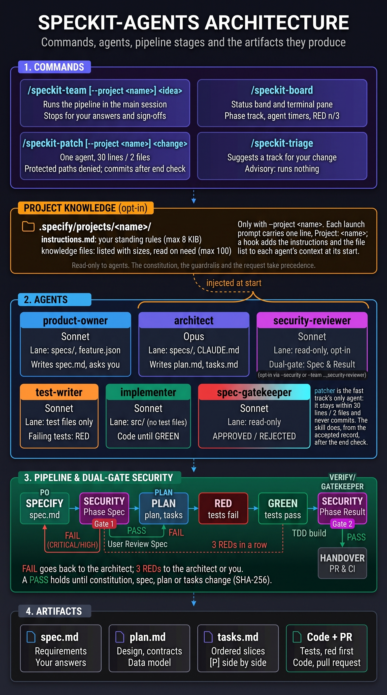
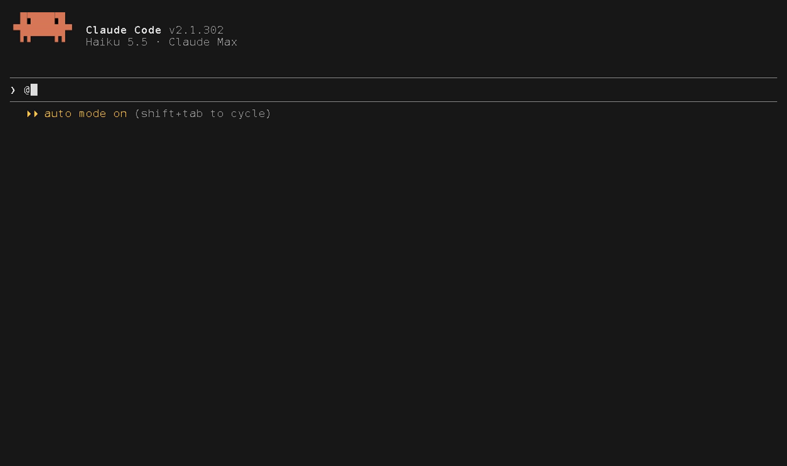
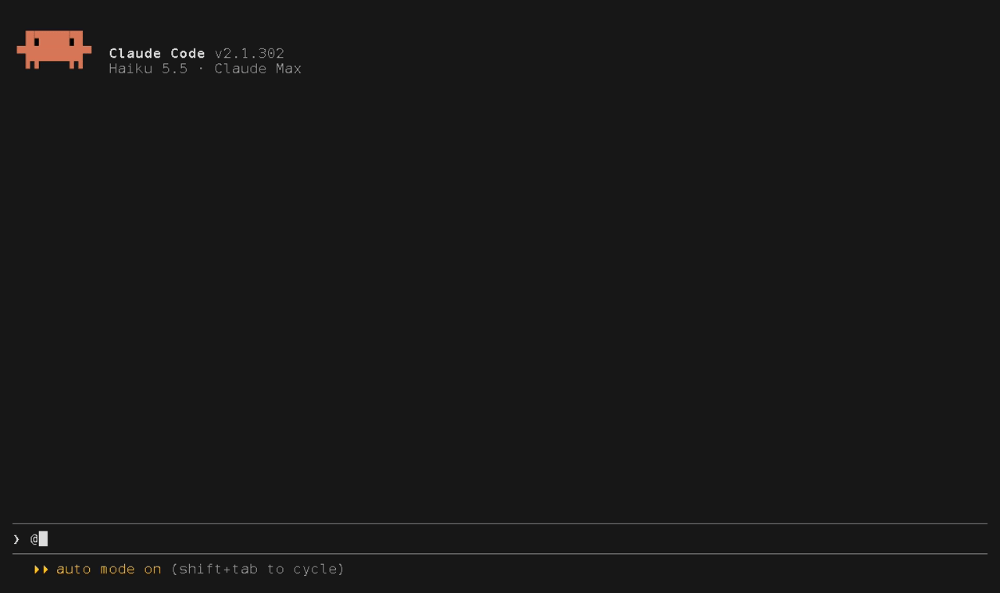
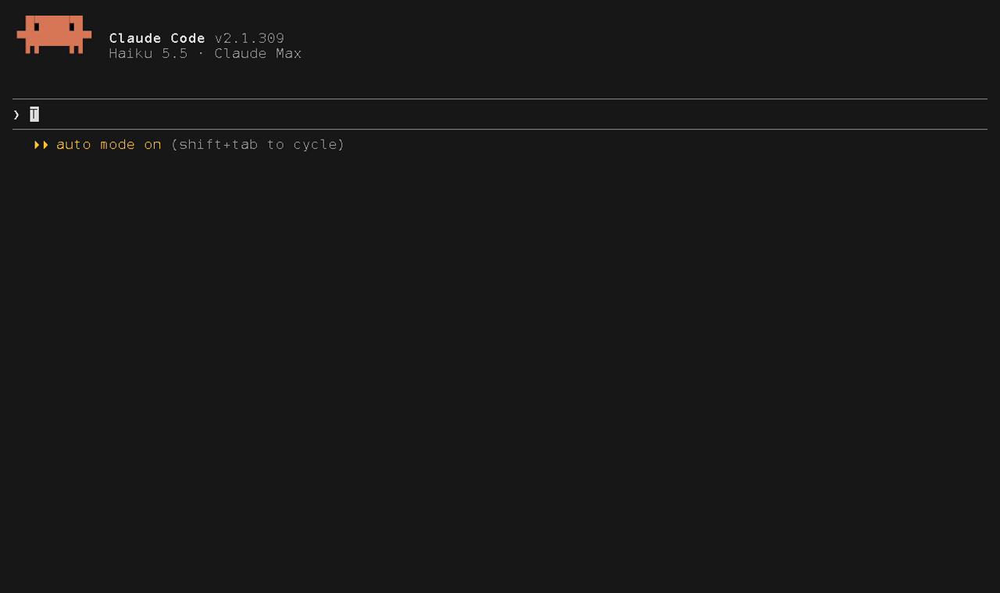
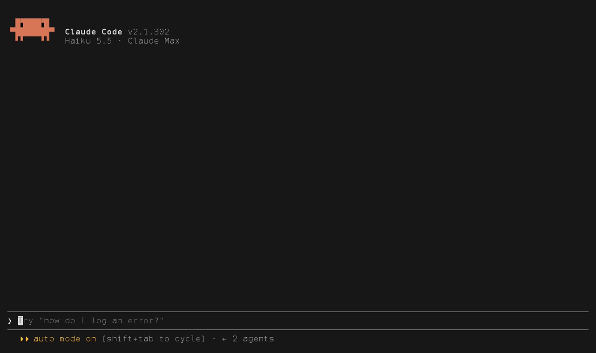
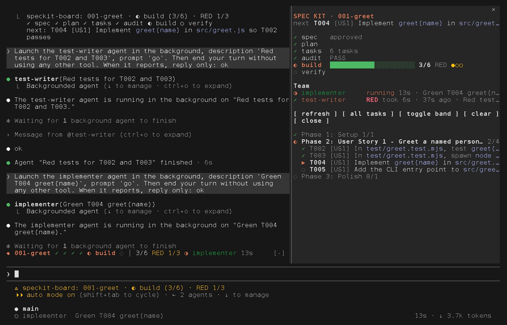

<div align="center">

# speckit-agents

**A Claude Code subagent team for GitHub Spec Kit, with the rules enforced by hooks.**

[](https://github.com/PIsberg/speckit-agents/actions/workflows/test.yml)
[](https://code.claude.com/docs/en/sub-agents)
[](https://github.com/github/spec-kit)
[](https://nodejs.org)
[](.github/workflows/test.yml)

[Install](#install) · [Quick start](#quick-start) · [The team](#the-team) · [How it works](#how-it-works) · [The fast track](#the-fast-track) · [Board mod](#board-mod-experimental) · [Troubleshooting](#troubleshooting)

</div>

A team of eight [Claude Code subagents](https://code.claude.com/docs/en/sub-agents) that carries a
feature through [GitHub Spec Kit](https://github.com/github/spec-kit), from idea to pull request.
Six of them each own one phase. [Hooks](https://code.claude.com/docs/en/hooks), not prompt text, keep
each one in its lane: the planner cannot write code, the implementer cannot touch tests, and
nobody writes code until an independent auditor has passed the spec. The seventh, `patcher`, is a
fast track beside the pipeline for a change of at most 30 production lines in 2 files
(`/speckit-patch`), with no spec, plan or audit; hooks keep it inside that budget too. The eighth,
`security-reviewer`, joins a run only when asked (`/speckit-team --security`).

```
idea ─► product-owner ─► architect ─► spec-auditor ─► per round: stubs─► red ─► green ─► spec-gatekeeper ─► PR
        spec.md          plan.md      VERDICT:        implementer  test-writer  implementer  APPROVED /
        + questions      tasks.md     PASS / FAIL                                  │         REJECTED
           ▲                ▲              │                                       │
           └── you answer   └── findings routed back on FAIL ◄── 3 REDs in a row ──┘
```



## Highlights

- **One agent per phase.** product-owner specifies, architect plans, spec-auditor audits,
  test-writer and implementer build test-first, spec-gatekeeper checks the result. Each one's
  phase instructions are Spec Kit's own skill. ([The team](#the-team))
- **Lanes are hooks, not requests.** A `Write` or `Edit` outside an agent's lane is denied before
  the file exists, and the denial tells the agent whose lane it is in; a change test-writer or
  implementer makes through Bash is caught when it stops. ([Guardrails](#guardrails),
  [The lane check](#the-lane-check))
- **No code before the audit.** A PASS is tied to a SHA-256 fingerprint of the constitution,
  spec, plan and tasks, and any edit to them other than ticking a task voids it.
  ([The audit gate](#the-audit-gate))
- **Test-first, one round at a time.** Stubs, then tests shown failing on an assertion, then the
  code that turns them green. ([Building in slices](#building-in-slices))
- **A retry limit.** After 3 `RESULT: RED` reports in a row, implementer is denied every tool but
  reporting back, and the way forward is a revised plan and a new audit.
  ([The retry limit](#the-retry-limit))
- **You decide at four stops, and you merge.** The pipeline asks which team to use, then asks you to
  answer the spec's questions, approve the spec, and approve the plan, then stops at the pull request.
  ([Quick start](#quick-start))
- **Or no agents at all.** `/speckit-team --team noagents <request>` runs Spec Kit's own commands
  in your session, with the spec and plan stops and no audit; only your typed flag turns the audit
  gate off. ([Choosing the team](#choosing-the-team))
- **A fast track for small changes.** `/speckit-patch <change>` launches one agent, `patcher`, with a
  budget of 30 production lines and 2 files, protected paths it cannot write, and no commit of its
  own: the main session commits its files, and opens the PR, only after an end-of-run hook check
  accepts the run. ([The fast track](#the-fast-track))
- **Free everywhere else.** Installed once for your user; in a repo without `.specify/` every hook
  exits immediately and allows the action. ([Guardrails](#guardrails))

## Contents

- [Getting started](#getting-started)
  - [Requirements](#requirements)
  - [Install](#install)
  - [Quick start](#quick-start)
- [What it looks like](#what-it-looks-like)
- [The team](#the-team)
- [Why This Architecture Succeeds](#why-this-architecture-succeeds)
- [Two modes, two sources](#two-modes-two-sources)
- [How it works](#how-it-works)
  - [The pipeline skill](#the-pipeline-skill)
    - [Running the roles as skills (`--team skill-agents`)](#running-the-roles-as-skills---team-skill-agents)
  - [The fast track](#the-fast-track)
  - [Project knowledge](#project-knowledge)
  - [Guardrails](#guardrails)
  - [The audit gate](#the-audit-gate)
  - [The retry limit](#the-retry-limit)
  - [The lane check](#the-lane-check)
  - [Test files](#test-files)
  - [State](#state)
  - [Context budget](#context-budget)
  - [Foreground launches](#foreground-launches)
- [Customising](#customising)
- [Board mod (experimental)](#board-mod-experimental)
- [Verifying](#verifying)
  - [Test suite](#test-suite)
  - [CI](#ci)
  - [End-to-end tests](#end-to-end-tests)
  - [Live check](#live-check)
  - [Live results](docs/live-results.md)
- [Troubleshooting](#troubleshooting)
- [Known limits](#known-limits)
- [Uninstall](#uninstall)
- [Developing](#developing)
- [Publications](#publications)

## Getting started

### Requirements

| Tool | Why | Check |
|---|---|---|
| [Claude Code](https://code.claude.com) | runs the agents. Needs subagent frontmatter `hooks:` and `skills:`, and the `UserPromptExpansion` hook event (verified on 2.1.291); for `--team skill-agents` also skill frontmatter `hooks:` and a model-invoked skill with `user-invocable: false` (verified on 2.1.310); the `omitClaudeMd` agent field for the read-only agents to start without your `CLAUDE.md` (verified on 2.1.293 and 2.1.310) | `claude --version` |
| [Node](https://nodejs.org) 18+ | every hook is a Node script | `node --version` |
| [git](https://git-scm.com) | the hooks use it to find the repo and diff an agent's work | `git --version` |
| [Spec Kit](https://github.com/github/spec-kit) (`specify`) | per repo, provides the phase skills | `specify --version` (verified on 0.8.11 and 1.1.2) |
| [uv](https://docs.astral.sh/uv/) | installs Spec Kit, a Python tool; nothing in this repo runs on it | `uv --version` (verified on 0.11.14) |

#### Installing uv and Spec Kit

uv is not preinstalled on macOS or Windows. Install it, then Spec Kit:

```sh
# macOS (or: brew install uv) and Linux
curl -LsSf https://astral.sh/uv/install.sh | sh
# Windows, in PowerShell (or: winget install --id=astral-sh.uv)
powershell -ExecutionPolicy ByPass -c "irm https://astral.sh/uv/install.ps1 | iex"

uv tool install specify-cli --from git+https://github.com/github/spec-kit.git
```

Spec Kit needs Python 3.11 or newer; uv downloads one if the machine has none. Open a new
terminal after installing uv so `uv` and `specify` are on `PATH`.

### Install

```sh
git clone https://github.com/PIsberg/speckit-agents.git && cd speckit-agents
./setup.sh                                               # macOS, Linux, Git Bash
powershell -ExecutionPolicy Bypass -File setup.ps1       # Windows PowerShell
node install.mjs                                         # anywhere Node runs
```

> [!IMPORTANT]
> Restart Claude Code afterwards: agents are loaded at session start.

#### What gets installed

The installer puts everything in your user-level Claude Code directory (`$CLAUDE_CONFIG_DIR`, or
`~/.claude`), so the team is available in every repository:

| Installed file | What it is |
|---|---|
| `agents/{product-owner,architect,spec-auditor,test-writer,implementer,spec-gatekeeper,security-reviewer,patcher}.md` | the eight subagents |
| `skills/speckit-team/SKILL.md` | the `/speckit-team` command that runs the pipeline |
| `skills/speckit-patch/SKILL.md` | the `/speckit-patch` command that runs the [fast track](#the-fast-track) |
| `skills/speckit-triage/SKILL.md` | the advisory `/speckit-triage` command: suggests which of the two to use, runs nothing |
| `skills/speckit-role-<role>/SKILL.md` | seven role skills, one per team role, generated from `agents/<role>.md` for [`--team skill-agents`](#running-the-roles-as-skills---team-skill-agents); `user-invocable: false`, so only that mode calls them |
| `hooks/speckit-team.mjs` | every guardrail |
| `settings.json` | three hook entries merged in (`PreToolUse`, `UserPromptExpansion`, and `SubagentStart` for the eight agents to record start and inject project context), and one allow rule for the exact line the fast track puts before `patcher`'s commands ([What the hooks stop](#what-the-hooks-stop)); your other settings, hooks and permissions are kept |

#### Installer options

| Flag | Effect |
|---|---|
| `--dry-run` | print what would change, write nothing |
| `--force` | replace same-named agents you wrote yourself (each is kept as `*.bak-speckit-agents` and put back on uninstall) |
| `--claude-dir DIR` | install into `DIR` instead of `~/.claude` |
| `--uninstall` | remove everything the installer wrote, and nothing else ([Uninstall](#uninstall)) |
| `--board` | also install the experimental [board mod](#board-mod-experimental); later reruns keep it |
| `--no-board` | remove the board mod, only if the installer installed it, and keep the team |
| `--no-fork` | write `"CLAUDE_CODE_FORK_SUBAGENT": "0"` under `env` in your `settings.json`, so the team's agents run in the foreground in every project ([Foreground launches](#foreground-launches)); only where no value is set, and later reruns keep it |
| `--fork` | remove what `--no-fork` wrote; a value you set yourself stays |

Any other argument is refused before anything is written, so a mistyped `--dryrun` stops with an
error instead of installing for real.

`--team` is not an installer flag: it is the first word of a `/speckit-team` request ([Choosing the team](#choosing-the-team)). `node install.mjs --help` lists it after the flags, under its own heading with the other slash commands.

There is no flag for the fast track: `patcher` and its two skills are always installed.

#### How the installer treats your files

- **Idempotent.** Rerun it after pulling changes.
- **In place.** It changes `settings.json` in place, keeping the file's own indentation and line
  endings, and updates its gate entries where they stand, so a rerun after another tool re-sorted
  the file changes nothing.
- **One backup.** The first time it changes your settings it keeps one copy of the original as
  `settings.json.bak-speckit-agents`.
- **Validates first.** It refuses to touch a `settings.json` that is not valid JSON or not a
  settings object (an array, a `hooks` entry that is not a list of objects, a `permissions` that is
  not an object or a `permissions.allow` that is not a list), and stops before writing anything.
- **Keeps a record.** It records what it created in `hooks/speckit-agents.install.json`.
- **Checks PATH without running anything.** It warns when `git`, `claude` or `specify` is not on
  PATH, by looking for the file. Running each with `--version` took 548 of an install's 750 ms on
  Windows, for `specify` alone; an install now takes about 150 ms.
- **Smoke-tests the hook.** It finishes by running the installed hook once, so a broken Node setup
  fails the install instead of silently disabling the guardrails.

### Quick start

#### 1. Set up a repository

In a repository:

```sh
specify init --here --integration claude
```

> [!NOTE]
> Keep `--integration claude`: without it, Spec Kit asks which assistant to set up, or, when it
> cannot ask, sets up GitHub Copilot, and the team then finds none of Spec Kit's skills. Spec Kit
> 0.10 removed the older `--ai claude` spelling.

On Spec Kit 1.x you can add `--extension git` to have Spec Kit name and create each feature
branch; without it, `/speckit-team` creates the branch itself after the spec is written. (Spec Kit
0.8 installs that extension by default and rejects the flag.)

#### 2. Run the pipeline

Then, in Claude Code:

```
/speckit-team Let users export their reading list as CSV
```

To ground the run in standing project rules, pass `--project <name>`: `/speckit-team --project billing Let users export their reading list as CSV` activates `.specify/projects/billing/` ([Project knowledge](#project-knowledge)).

To run only some of the roles, name them: `/speckit-team --team test-writer,implementer add a hello.txt
that says hello` skips the team question ([Choosing the team](#choosing-the-team)). To run no agent
at all, `/speckit-team --team noagents <request>` has the session run Spec Kit's own commands
itself, with the spec and plan stops and no audit.

Start it in a fresh session (`/clear` first): every response of the run re-reads the conversation,
earlier work included. In the 004 run that earlier work was 2.73M of the main session's 8.92M
([Feature 004](docs/measurements.md#feature-004-interactive)).

`/speckit-team` runs the whole pipeline from the main session. It stops for you at four points:

1. to choose the team, unless `--team` names it: the full team, build only, implement only, or
   spec and build with no audit; 
2. to answer the product owner's questions;
3. to approve the spec;
4. to approve the plan and tasks. If `tasks.md` has two or more `[P]` slices that touch disjoint
   files, this stop also asks whether to build them side by side or one at a time.

In a repo whose constitution (the rules every phase is checked against) is still Spec Kit's
template, it first drafts one from what the repo already states (`CLAUDE.md`, the build file, CI)
and asks you to approve it, a further stop, then writes it with `speckit-constitution` and commits
it on the feature branch, not on main. You can still run `/speckit-constitution` yourself
beforehand.

After that it audits, then builds the feature in rounds of up to 4 slices (stubs, failing tests,
code), small phases of `tasks.md` sharing one, verifies and opens a PR, which it does not merge.

#### 3. A small change: the fast track

For a typo, a config value or a small bug fix, skip the pipeline:

```
/speckit-patch Fix the typo "recieve" in README.md
/speckit-patch --project billing Fix rounding on tax calculation
/speckit-triage Add a --json flag to the export command
```

`/speckit-patch` creates the branch `patch/<slug>` and launches `patcher` once. The hooks hold it
to 30 production lines in 2 files (tests and docs are not counted) and keep it out of protected
paths such as `specs/`, `.specify/`, `.claude/` and `.github/`. `patcher` ends with one of three
words: `DONE` (the existing tests passed), `FAILED`, or `ESCALATE` (over budget or in need of a
protected file: the work stays uncommitted and `/speckit-team` is the way on).

Who commits: `patcher` never does. After `DONE` and an end check that accepts the run, the main
session commits the files `patcher` changed, pushes the branch and opens a PR, which it does not
merge. A run in which `patcher` changed no file commits nothing and opens no PR. Files you had
uncommitted before the run are left out of the commit.

`/speckit-triage <request>` only prints one line suggesting `/speckit-patch` or `/speckit-team`;
it launches nothing and you type the command. How the budget and the checks work:
[The fast track](#the-fast-track).

#### Running one phase

You can also run one phase at a time by @-mentioning an agent:

```
@agent-spec-auditor audit the active feature
@agent-implementer do T007 and T008
```

## What it looks like

Real sessions in a scratch Spec Kit repo, the main session on Haiku
([`record.mjs`](docs/media/record.mjs) now puts every agent on Haiku too; before
[#39](https://github.com/PIsberg/speckit-agents/issues/39) they ran on their own models), so your
runs will word things differently. The three recordings that wait on agents are sped up 2x or 4x.
`node docs/media/record.mjs` records them again (see
[Recording the demo media](#recording-the-demo-media)).

### The team in the `@` typeahead

Typing `@` lists the agents Claude Code knows, each with its description, after the repo's
folders. Claude Code stops the list at 15 entries. In the recording below (Claude Code 2.1.302,
2026-10-17) it shows six of the team's eight agents among Claude Code's own five: spec-gatekeeper and
test-writer, last in alphabetical order, are left out. Claude Code 2.1.295 removed the `/agents` menu
this section used to show.



### A subagent at work

`@agent-spec-auditor` audits a feature inside the main session: the collapsed progress view, the
full transcript with Ctrl+O, then the `VERDICT:` it hands back, which a hook records for the
implementation gate. Recorded on 2026-10-17 (Claude Code 2.1.302) with `CLAUDE_CODE_FORK_SUBAGENT=0`
and a prompt asking for `run_in_background false`: with fork subagents on, an interactive session's
default, the agent runs in the background and reports as a message instead
([Foreground launches](#foreground-launches)). On the demo feature it returns `VERDICT: FAIL`.



### A guardrail firing

architect is told to write `src/greet.js`. Its scope hook denies the write before the file exists,
and the denial tells the agent whose lane production code is in.



### The pipeline

`/speckit-team` first asks which team to use, the team question, the first of the pipeline's four
stops (the demo answers it with the full team). It then launches product-owner, which writes the
spec and returns its questions, and the main session puts product-owner's questions to you: the
second. Recorded on 2026-10-17 (Claude Code 2.1.302) with the idea "Let greet say hello in the
user's own language": product-owner, in the background as in any interactive session with fork
subagents on, wrote `specs/002-localized-greeting` and returned two questions. Haiku's first call to
ask them failed on an empty second question ("Invalid tool parameters"), and it asked again.



## The team

| Agent | Spec Kit phase | May write | Hands over | Model |
|---|---|---|---|---|
| [`product-owner`](agents/product-owner.md) | specify, clarify | `specs/`, `.specify/feature.json` | `spec.md` and up to 5 questions with recommended answers | sonnet |
| [`architect`](agents/architect.md) | plan, tasks | `specs/`, `CLAUDE.md` | `plan.md` and `tasks.md`, plus `research.md`, `data-model.md`, `contracts/` or `quickstart.md` only when the feature has something for them: the minimal design that meets the spec, each fact said once | opus |
| [`spec-auditor`](agents/spec-auditor.md) | analyze | nothing | `VERDICT: PASS` or `FAIL`; FAIL only on CRITICAL or HIGH findings, MEDIUM and LOW are listed and accepted | opus |
| [`test-writer`](agents/test-writer.md) | TDD red | test files, `tasks.md` | committed tests, each shown failing on an assertion, never on a parse, import or compile error; the report ends `RED`, or `BLOCKED` with what stopped it, or `FIXED` when it only corrected an existing test and the suite is green | sonnet |
| [`implementer`](agents/implementer.md) | stubs, TDD green | anything except test files and `.specify/` | signature stubs (`RESULT: STUB`), or committed code with the tests that cover it green, and the full suite in the last round (`RESULT: GREEN` / `RED`) | sonnet |
| [`spec-gatekeeper`](agents/spec-gatekeeper.md) | final check | nothing | `APPROVED` or `REJECTED`, with a requirement-to-test table | sonnet |
| [`security-reviewer`](agents/security-reviewer.md) | opt-in review | nothing | `VERDICT: PASS` or `FAIL`; reviews spec state and reviews implementation result | sonnet |
| [`patcher`](agents/patcher.md) | fast track | the working tree except protected paths, within 30 production lines and 2 files, never a commit | a report that `/speckit-patch` commits from, ending `DONE`, or `ESCALATE` or `FAILED` | sonnet |

Each agent's phase instructions are Spec Kit's own skill (`speckit-plan` and so on), preloaded
into the agent with the `skills:` frontmatter field. The agent file adds only what Spec Kit does
not say: its inputs, its lane, and the shape of its report. Those bodies are 27 to 114 lines long,
blank lines not counted; the architect's is the longest. `patcher` is the exception to the
preloaded skill: it runs no Spec Kit phase, so its 32-line body carries the whole job.
`test/install.test.mjs` counts them.

### Why the prompts are short

A long prompt dilutes the rules that matter, and a rule in prose is a request. "Never edit tests"
in a prompt will hold most of the time. A hook that rejects the edit holds every time, and its
rejection message tells the agent what to do instead.

### Why each agent has a narrow description

Claude Code puts every agent's description into every session so it can route work. These eight
total about 2,100 characters (2,090 counted in the `description:` lines), about 520 tokens. The token figure is an estimate, not a measurement: 2,090 characters at the usual 4 characters per token for English text (counting tokens needs a model call, which was not made). Each one says when to use the agent and what it
will not do, so routing does not have to guess.

## Why This Architecture Succeeds

**Prevents "Garbage In, Garbage Out":** Most agent pipelines fail because the initial spec is
vague, and the coding agent fills in the blanks with hallucinations. Your product-owner forcing a
human-in-the-loop Q&A step before architecture ensures the foundation is solid.

**True TDD Validation:** LLMs are notoriously bad at writing tests for code they just wrote; they
tend to write tautological tests that just mock everything to ensure a pass. Forcing the
test-writer to write failing tests first proves the agent actually understands the acceptance
criteria.

**Circuit Breakers:** The spec-auditor acts as a firewall. If the architect designs a plan that
violates the spec, it gets kicked back before you waste tokens and time generating useless code.

**Role-Based Access Control (RBAC):** Using hooks to enforce file-system permissions per agent is
the most reliable way to orchestrate multi-agent systems today.

## Two modes, two sources

One install gives you two ways to run the same pipeline, and each is built on ideas from a different
public repository. Only ideas: no code was copied from either.

| | Agents (the default) | Skills (`--team skill-agents`) |
|---|---|---|
| Shape | seven subagents, each in a fresh context with only its launch prompt | seven role skills run in your session, one growing context |
| Inspired by | [google/elephant-goldfish-model](https://github.com/google/elephant-goldfish-model) | [addyosmani/agent-skills](https://github.com/addyosmani/agent-skills) (111,114 stars on 2026-10-27, read with `gh api`) |
| What was taken | reviewers that read only their target and the sources they are pointed at ([Context budget](#context-budget)); a reuse check before a new utility ([the spec-auditor](#the-audit-gate)); a human-decided CONTEST path for findings ([Routing findings](#routing-findings)); a drift report of specs against code ([Checking old features for drift](#checking-old-features-for-drift)); a parent-only marker that no agent may receive ([Full run with real models](#full-run-with-real-models)) | work done by skills loaded into the session instead of by launched agents; pressure cases where the request argues for skipping the process, scored with and without a change ([Scored cases and arms](#scored-cases-and-arms)); a lexical description-collision check over the skills; fresh-eyes review, rationalization tables and authoring rules, tracked as [#186](https://github.com/PIsberg/speckit-agents/issues/186), [#187](https://github.com/PIsberg/speckit-agents/issues/187) and [#189](https://github.com/PIsberg/speckit-agents/issues/189) |
| Strength | independent review and the strongest guardrails: Claude Code holds each agent to its tools and the hooks end with it | no handoffs and no re-reading across roles; the one measured fixture run cost 58% less |
| Weakness | lossy handoffs, and every launch pays for a fresh context | every role sees the whole conversation, so review is not independent, and several guardrails are prompt text ([the table](#running-the-roles-as-skills---team-skill-agents)) |

The two modes share the hook, the audit gate, the lanes and the reports, so a feature can be built
either way and judged by the same gate. [Agents or skills](#running-the-roles-as-skills---team-skill-agents)
says which to choose; the numbers behind the table are in [`docs/measurements.md`](docs/measurements.md).

What is and is not shown. Measured: the cost gap above, from one run per mode. Taken from the
agent-skills repository so far: the harness ([#188](https://github.com/PIsberg/speckit-agents/issues/188)).
The prompt changes it suggests (#186, #187) are only kept if the harness shows they change a verdict
at a bounded cost, and their results go in [`docs/measurements.md`](docs/measurements.md) either way.
Not shown: that either mode is better than the other for a large feature, and that the agent-skills
ideas improve this team's runs.

## How it works

Two commands, both skills that run in the main session: [`/speckit-team`](skills/speckit-team/SKILL.md)
launches each agent of the pipeline in turn, and [`/speckit-patch`](skills/speckit-patch/SKILL.md)
launches `patcher` once. Every rule that must hold is a mode of one hook script,
[`hooks/speckit-team.mjs`](hooks/speckit-team.mjs): the skill decides what happens next, and the
hooks decide what is allowed.

### The pipeline skill

`/speckit-team` runs in the main session, because only the main session can talk to you. It
launches each agent with the inputs it needs and relays the product owner's questions to you.

#### Choosing the team

`/speckit-team [--team <role>[,<role>...]] [--security] <request>`. `--team` counts only as the first word; names are
case-insensitive and order does not matter. Without it the skill asks one question before any
launch, a stop like the others: Full team (recommended), Build only (test-writer, implementer),
Implement only (implementer), or Spec and build with no audit or verification (product-owner,
architect, test-writer, implementer). Its free-text answer is a role list. All six core roles is the full
team. The `security-reviewer` is opt-in, included via `--security` or named in `--team` (`security-reviewer` or alias `security`). `patcher` is not a team role.
Two typed forms run no agent: `--team noagents` (Spec Kit's own skills, below) and
`--team skill-agents` (the team's roles as skills in your session, [below](#running-the-roles-as-skills---team-skill-agents)).

The skill refuses before launching anything, naming the valid roles: a name that is not a role;
`noagents` with a role; neither test-writer nor implementer; architect without product-owner;
spec-auditor without architect.

`/speckit-team --team noagents <request>` runs no agent at all. The session runs Spec Kit's own
skills itself, `speckit-specify`, `speckit-plan`, `speckit-tasks` and `speckit-implement` in that
order, asks you the spec's open questions, and stops for you to approve the spec and then the plan
and tasks. There is no audit, no verification by spec-gatekeeper and no agent hook; the session
runs the tests itself, stops fixing after 3 failed runs of the same tests in a row, and opens the PR
as any run does. Each agent of the full team starts from 11k to 14k tokens before it reads a file
and reads the code again ([Context budget](#context-budget)); here nothing is launched, though what
that saves on a whole run is not measured yet. It is chosen only by typing it: the typed command reaches the hook
(`UserPromptExpansion`), which records it for the session, so this request's `speckit-implement`
passes the [audit gate](#the-audit-gate). That is why the team question does not offer it, and why
a model's `Team:` line can never ask for it. The record ends at your next `/speckit-team`, or at a
launch of a team agent, after which the full gates apply again.

What an absent role skips, and the guardrails that go with it:

| Absent role | Steps skipped | Guardrails skipped |
|---|---|---|
| `product-owner` | the spec, its questions, the spec review stop | none |
| `architect` | plan and tasks, the plan stop, rounds by phase (one round instead) | spec-gatekeeper's open-task check; at the retry limit you decide, there is no architect to rethink |
| `spec-auditor` | the audit and its FAIL routing | the audit gate on test-writer and implementer |
| `test-writer` | the red step; the test tasks stay unticked | spec-gatekeeper's test trace and its open-task check on the test tasks |
| `implementer` | the stub and green steps; the other tasks stay unticked | the stub pass (a test failing on a missing symbol counts as red), spec-gatekeeper's passing tests and its open-task check on those tasks |
| `spec-gatekeeper` | verification and REJECTED routing | the recorded last word |
| `security-reviewer` | the security review of the spec and the security review of the result | its `ends` check on the `VERDICT:` line |

Every run keeps the hand-over (PR and CI), each chosen agent's `scope`, `lane`, `ends` and `result`
hooks, the retry limit while implementer is chosen, tests before implementation when both
test-writer and implementer are chosen, and the `/speckit-implement` gate. A run that is not the full
team starts with a one-line notice naming the skipped steps and ends with a report that lists them,
the unticked tasks and the skipped audit gate.

Without product-owner and architect the build roles work from the request text in one round, and
with product-owner only from the approved `spec.md`; with neither, the skill creates a
`team/<request>` branch when the tree is on `main`. Every launch prompt of such a run carries a
`Team: test-writer, implementer` line, which the hook and spec-gatekeeper read; spec-gatekeeper's
prompt also carries `Unbuilt: T001, T003` when test-writer or implementer is absent and `tasks.md`
exists, naming the tasks nobody builds.

#### Running the roles as skills (`--team skill-agents`)

`/speckit-team --team skill-agents <request>` runs all seven roles in your session, each as an
installed skill (`speckit-role-<role>`), and launches no agent. Type it; the team question does not
offer it, and a free-text answer of `skill-agents` only gets a reminder of the typed form. It takes
no role names and not `noagents`, and combines with `--security` and `--project`. The hook starts
the mode from the typed command (`UserPromptExpansion`) and answers with a start message. If a
`speckit-role-<role>` skill is missing it blocks and tells you to run `node install.mjs`. Launching
any agent ends the mode.

Each role skill carries its own hooks in its frontmatter: `scope role` on writes and `lane role` at
Stop (see [Guardrails](#guardrails)). The gate on the Skill call checks the audit before
test-writer, implementer and spec-gatekeeper, and again before spec-gatekeeper, so an edit to the
spec, plan or tasks made inside the build roles never reaches verification unaudited.

| | Enforced by the hook | Not enforced |
|---|---|---|
| Lane | each role's write scope, and its lane check when it closes | a role's lane after a turn that ended without a Stop (an interrupt, an API error): its lane check and report do not run; and, not observed either way, after a background task's notice, a compaction or a message typed mid-turn, if Claude Code gives it a new `prompt_id` (#184) |
| Audit gate | before test-writer, implementer and spec-gatekeeper, at their Skill call | on each tool call inside test-writer and implementer: a spec, plan or tasks edit there is caught when the next of them, or spec-gatekeeper, starts |
| Verdict | spec-auditor's `VERDICT:` and spec-gatekeeper's word are read from the role's messages, from the first `args` line of the next Skill call (the skill starts it with the report's last line, because the transcript may not hold the message yet), and from the Stop's last message, and recorded; the gatekeeper's word is the last line that is only `APPROVED` or `REJECTED`, so hand-over text after it in the same response does not hide it (#185) | that a report ends in its word: nothing refuses a report once, as `ends` does for an agent |
| Retry limit | nothing | the skill counts 3 `RESULT: RED` in a row itself; the hook does not |
| Context | nothing | every role sees this conversation, with the session's `CLAUDE.md`, on the session's model; read-only roles lose the `omitClaudeMd` isolation |
| Tool list | a read-only role's Write and Edit are denied | each agent's tool list: a role may use every tool of this session, MCP tools included, and a read-only role's write through one is not checked |

**What was verified how.** Verified live (Claude Code 2.1.310, 2026-10-25): the start message, an
audit denial of a `speckit-role-test-writer` call with no audit, and a Write outside architect's lane
denied ([Live results](docs/live-results.md), "Skill-agents"). Measured: the same fixture request
built once as the default team and once with `--team skill-agents`, 31% more input tokens and 58%
less cost, one sample each ([`docs/measurements.md`](docs/measurements.md)). Covered by test only:
the typed-form refusals, the install, rerun and uninstall of the role skills, the role record's
close, the verdict and word records (the `args` line and the Stop's last message paths included), and the rest of the table; the
end-to-end tests fire the role skills' hook entries against the real Claude Code. The role's end with its turn is read from Claude Code's `prompt_id`; end to end covers only a resumed prompt ending the role. Not verified at all: an interrupt, an API error's StopFailure and an AskUserQuestion answer (read in the 2.1.293 bundle, never seen running), and whether a background task's notice, an auto-compaction summary or a message typed during a turn gets a new `prompt_id` (not known; if one does, the acting role ends mid-turn with its lane unchecked for the rest of the turn, which the start message names, [#184](https://github.com/PIsberg/speckit-agents/issues/184)).

**Agents or skills.** An agent starts each role in a fresh context with only its launch prompt, and
returns a capped report. A role skill loads its instructions into your session, so every role works
in one context that keeps growing. The numbers below are the one pair of runs of 2026-10-25 in
[`docs/measurements.md`](docs/measurements.md); the rest follows from the design.

| | Agents (default) | Skills (`--team skill-agents`) |
|---|---|---|
| Fixture run, 2026-10-25 | $1.86, about 15 min, 2.41M input tokens over 10 launches | $0.78, 5 min 17 s, 3.16M input tokens in one session, peak context 105k against 72k |
| Context | each role starts near 14k tokens and reads the code again | nothing is re-read across roles, but every response re-reads everything before it, so a large feature can reach compaction |
| Handoffs | lossy: a role knows only its prompt, and a wrong prompt costs a relaunch | none: a later role sees what earlier ones settled |
| Independent review | spec-auditor and spec-gatekeeper never see the reasoning they judge | every role sees the whole conversation, the reviewers included |
| Guardrails | Claude Code holds each agent to its tools, and its hooks end with it | rebuilt by the hook: a role ends on a new `prompt_id`, and only its report is read from the transcript; the table above lists what is not enforced |
| Models | per role: architect and spec-auditor on opus | the session's model for every role |
| Side-by-side slices | yes, in worktrees | no |

Choose agents for a large feature, for review that should not have seen the reasoning, for the
strongest guardrails, or for opus on the hard roles. Choose skills for a small or medium feature you
will watch, when time and cost matter more than an independent review. Part of the cost gap is the
model mix: the default run's architect and spec-auditor ran on opus, so the pair is not a
like-for-like price comparison. Whether skills still win on a feature large enough to fill the
context is not measured.

#### Settling decisions

The architect writes each decision you should confirm (a new dependency, a schema or public API
change, a rule with more than one reasonable reading) to an `## Open Decisions` section of
`plan.md`: the options, its recommendation first, and what follows from each option (edge cases,
counts, side effects, the requirements and tasks it changes). An option that would make a line of
the spec wrong carries that line's new wording on a `Spec:` line. Its report names only the
decision IDs, so the reasoning is not carried in the main session for the rest of the run. At the
plan stop the skill reads the section in one command and asks you about every open decision at
once; with more than 4, its first question takes every recommended option in one answer, in which
you can also name exceptions (`D5: B`). The architect writes the plan and the tasks as its
recommendations make them, so when every answer is the recommended option the main session launches
no one: it adds `Answer (<date>): <option>, as recommended` under each decision, renames the section
`## Decisions` and puts the chosen `Spec:` lines into the spec itself (in the full run of 2026-10-24
that was an architect and a product-owner for one edit each, 0.16M tokens). Otherwise one architect
revision applies all the answers, moving each entry to a `## Decisions` section with the answer and
the date, and product-owner, launched in the same message, rewords the spec lines the chosen options
carry. The spec and the
plan then agree before the first audit; in the 004 run a decision that contradicted FR-012 failed
it ([Feature 004](docs/measurements.md#feature-004-interactive)).

Work that nothing in `spec.md`, the constitution's MUST rules or `CLAUDE.md` requires, such as a
re-recording or an extra live check, is an open decision too, and its recommended option leaves the
work out, so taking every recommendation keeps the run to what was asked
([#89](https://github.com/PIsberg/speckit-agents/issues/89)). Work `CLAUDE.md` asks for counts as
required, so the architect never recommends against the repository's own instructions.

Code the repository already has is not built twice. Before a task adds a function, type or module,
the architect greps the source for one that does the job and, if it finds one, names it in the task
as file and symbol. spec-auditor checks the same: for each new file, function and type the
implementation tasks list, it greps the source by name and by job and reads only the matching lines,
and a second implementation of existing behaviour is a HIGH finding for the architect, citing both
places. It is grep, not a reading of the codebase, so it finds a duplicate whose name or job words
match and misses one that shares neither. A duplicate caught here costs one architect revision;
caught later it costs a test-writer and an implementer for code that should not exist. The idea is
the reuse check of the Zoom Out reviewer in
[google/elephant-goldfish-model](https://github.com/google/elephant-goldfish-model)
(`agents/zoom_out.md`), which must search the code before it accepts a new utility.

When your answers, or an audit's findings, fully determine the edits (a value, a list entry, a
wording), the skill sends a *dictated* revision: each exact edit and where it goes, which the
architect makes by grep without re-reading the artifacts. An answer that drops or renames an ID is
one edit for every mention, which the architect finds by grep. Anything that needs design
judgement, and any edit the architect finds changes more than it was told, gets a full revision.
The orchestrating session never edits the plan itself: a response there re-reads a much larger
context than an architect's ([Feature 003](docs/measurements.md#feature-003-interactive)).

#### Routing findings

On a FAIL it routes each CRITICAL and HIGH finding to the agent that owns it; MEDIUM and LOW
findings are accepted and listed once at hand-over. On a REJECTED it routes each reason the same
way. After two failed audits it hands the findings to you.

An owner that finds a finding wrong does not have to obey it. product-owner and architect may report
it `contested`, with the file:line that shows the auditor misread the spec, plan, tasks or
constitution, and edit nothing for it. The skill does not judge the contest: it asks you, with the
finding and the evidence, whether to fix it or uphold the contest. An upheld contest is recorded,
under `## Decisions` in `plan.md` or `## Clarifications` in `spec.md`, and spec-auditor and
security-reviewer do not raise a recorded ruling again unless they cite something it did not
consider. Without this, a wrong finding costs a revision and a re-audit, and after two FAILs it
reaches you anyway. The idea is the CONTEST path of
[google/elephant-goldfish-model](https://github.com/google/elephant-goldfish-model)
(`skills/egm_resolve/SKILL.md`), where the human decides each contested finding. `test/install.test.mjs`
holds the skill, both owners and both reviewers to the same words.

#### Building in slices

After the audit it builds the feature in rounds, never in one shot. A slice is one small
implementation task plus the test tasks that cover it, and the architect writes `tasks.md` in
those slices. A round is at most 4 slices in task order, and gets one stub pass, one test-writer and
one implementer; phases of `tasks.md` (Setup, Foundational, one user story) that fit in 4 slices
together share a round, since each extra round costs a test-writer and an implementer more. The
architect never makes a slice of an implementation that leaves out what a later task adds just so
that task's test fails against it: in the full runs of 2026-10-24 and 2026-10-25 `sum()` without its
empty-array case became a slice of its own that way, which cost a round. The architect's report
ends with one line per round (`Round 1: stub T001; red T002; green T003`), so the main session
launches the first round straight from the audit's PASS instead of spending a response, 60k tokens
in the 2026-10-25 run, on reading `tasks.md`. Until
2026-10-10 every slice was its own round, so a feature cost up to three agent launches per
implementation task, each starting from nothing (11k to 14k tokens, see
[Context budget](#context-budget)) and reading the code again; that was most of why a run felt
slow next to plain prompting. The round size is a prompt rule; how much it saves in a full run is
not measured yet. For each round:

1. **Stubs.** If the tests will call code that does not exist yet, implementer first creates the
   signatures the task lists, with bodies that only signal "not implemented", and reports
   `RESULT: STUB`. This is what lets the next step fail cleanly.
2. **Red.** test-writer writes the round's tests and loops until each one fails on an assertion
   or on the stub's not-implemented signal. A test that fails because it does not parse, an
   import is missing or a name is undefined proves nothing about the behaviour, so test-writer
   fixes it (at most 3 rounds per test) and the skill sends back any that still fail that way.
   test-writer also runs the type check CI runs over tests, and works out on the current code any
   value an assertion compares with that the code already decides: a task asking for a number no
   implementation can meet is reported, before any implementer runs, not written as a red test.
3. **Green.** implementer makes the round's tests pass, under the [retry limit](#the-retry-limit).
   It runs the tests that cover its change; the full suite runs only in the last round, which the
   skill names, and once more at spec-gatekeeper. In the 004 run every round ran it: 5 runs, about
   14.5 of the 48 agent-minutes.

The failure-reason check in step 2 is prose: the hooks cannot tell an assertion failure from a
compile error in an arbitrary language, so the skill checks test-writer's pasted output.

Every agent that runs tests gives the run a Bash `timeout` that covers it. Past Claude Code's
default of 2 minutes the command moves to the background, where a subagent cannot wait for it:
`sleep` is blocked and Monitor is not one of its tools. In the 004 run one implementer waited
234 s that way on an `npm test` it then ran again.

When the last round is GREEN and every task in `tasks.md` is ticked, it launches spec-gatekeeper
straight away, without asking: between the stops above it never waits for you. A task still
unticked at that point (a final test run, say) becomes one more implementer round, and the ticks
made while building never void the audit.

#### Parallel slices

For `[P]` slices of a round touching disjoint files, it can run one loop per slice at once, each
implementer in its own git worktree, merged back into the feature branch in task order. It does so
only if you say so at the plan stop, and recommends one at a time. Each slice side by side gets its
own test-writer and implementer instead of sharing its round's, the merges take main-session
responses, and several agents draw on your usage limits at once. Measured on 2026-10-25 with real
models ([#114](https://github.com/PIsberg/speckit-agents/issues/114)), one two-slice feature
(`sum()` and `capitalize()` in two files, `tools/full-run.mjs --two-slices` and `--side-by-side`):

| Build, first stub to last implementer | One at a time | Side by side |
|---|--:|--:|
| Wall-clock | 95 s | 140 s |
| Build launches | 3 | 7 |
| Build agents' input | 0.20M | 0.57M |
| Main-session responses, whole run | 13 | 19 |

Slices that take seconds each gain nothing from running at once; the launches, the merges and
the cleanup cost more than the overlap saves. Side by side can pay off only for slices that each
take minutes, which no run has measured. The side-by-side run also had two stub implementers, a
docs-only implementer and a commit to take out worktrees, since fixed (below); the one-at-a-time
run already had the architect's round lines, which save the main session one response.

Claude Code does run them side by side: agents launched in one message overlap, in worktrees too,
and the main session waits for all of them, checked against a fake API and pinned by
[`test/e2e.test.mjs`](test/e2e.test.mjs) ([#40](https://github.com/PIsberg/speckit-agents/issues/40)).
The same check shaped the rules for worktrees. A worktree starts from the last commit, without
uncommitted work, so the main session commits the round's tests in the message that launches the
implementers. An implementer there ticks nothing in `tasks.md`, because ticks on adjacent lines in
two branches conflict when merged; after each implementer step the main session merges the branches,
removes each worktree and its branch, and only then ticks the tasks the reports name and commits.
The worktrees sit in the repository's `.claude/worktrees/`, so a `git add -A` before the removal
commits them as embedded repositories, as the first side-by-side run with real models did
(2026-10-25). The round's stub pass stays one implementer without a worktree: stubs take seconds,
and two of them in worktrees cost that run a launch and a merge more.

#### Handoffs are lossy on purpose

A subagent never sees the main session's conversation; it starts with the prompt the skill writes
and whatever files it reads. So the skill passes each agent only what its Inputs section lists,
and never the chat, the product owner's questions and answers, or another agent's full report.
implementer gets the slice's task IDs and test-writer's report for them, and its own prompt tells
it to read `tasks.md`, the failing tests and the code they touch, not `spec.md`, `plan.md`,
`research.md` or `data-model.md`. The tests are its spec.

The three agents that cannot write, spec-auditor, spec-gatekeeper and security-reviewer, also start
without your `CLAUDE.md` files, the user's and the project's (`omitClaudeMd: true` in their
frontmatter). What they check is in the files their Inputs name, and a rule they must hold belongs in
the constitution, which all three read. spec-gatekeeper still opens the project's `CLAUDE.md` as a
file when the CI workflow does not name the gates. The idea is the Goldfish reviewer of
[google/elephant-goldfish-model](https://github.com/google/elephant-goldfish-model), which reads only
the target and the sources it is pointed at. Claude Code writes that context again on every launch,
so each of these launches skips it: 17,351 characters less in the first message on the machine
measured ([CLAUDE.md in the read-only agents](docs/measurements.md#claudemd-in-the-read-only-agents)).
The agents that write keep both files, for the repo's build commands and conventions.

What the architect found is handed on in `tasks.md`: every task names the file and symbol of each
function, type, test helper and API member it uses, so test-writer and implementer go straight to
it. In the 004 run the plugin API's types were explored by the architect, then by implementer and
test-writer again (19k, 17k and 9k characters). A test task names its test file, the requirement
and scenario IDs it covers and only what `spec.md` and `contracts/` leave open; test-writer reads
the cited lines and writes the cases. No agent reads another feature's artifacts as an example:
in the 004 run the architect and product-owner read 40k characters of them.

The main session re-reads its whole context with every response, so the skill spends as few as it
can. The approved spec and plan are committed in the message that launches the next agent: Claude
Code runs the calls of one message in order, which [`test/e2e.test.mjs`](test/e2e.test.mjs) pins,
so the commit lands before the agent starts and needs no request of its own.

While an agent works, Claude Code shows the Agent call's description and the agent's tool calls,
a Bash call as its command, and never the agent's own text or a Bash call's description (checked
on 2026-10-10 against Claude Code 2.1.296's interface, driven by vhs against a fake API). So the
skill makes the description name the step and its task IDs, says before each launch what the
agent will do, and after each report what it changed and how long it took.

### The fast track

`/speckit-patch <change>` is for a change too small for the pipeline. One run:

1. The skill (main session) checks that `.specify/` exists, notes the start commit, the installed
   hook's hash and the remote-tracking refs, and creates `patch/<slug>` from the current commit.
2. It launches `patcher` once, in the foreground. `patcher` changes the working tree and runs the
   repo's existing tests, and a hook measures it on every tool call.
3. When `patcher` reports, the end check decides whether the run is accepted (see below).
4. Only if it is, and the report is `DONE` with the tests passed, the skill commits the files in the
   accepted record, pushes `patch/<slug>` (never forced) and opens a PR if there is a GitHub remote.
   It does not merge. `patcher` itself cannot commit, push or run `gh`.

So the skill decides what happens next and the hooks decide what is allowed, as in the pipeline. A
commit made before the end check would hold whatever the run did, and a push cannot be undone; this
way nothing leaves the working tree until the check has looked at the whole run.

#### The budget

At most 30 changed production lines in at most 2 production files; 30 is within and 31 is over. No
binary production file. The hook measures against the commit the run started from:

- Per production file, the larger of its insertions and deletions in `git diff --numstat`, so a
  modified line counts once and 30 modified lines fit. An untracked production file counts its
  lines.
- A rename between production files is 1 file and only its edited lines, so a pure rename is 0
  lines. A test or doc moved into production code counts as a new production file. A move git does
  not pair as a rename, such as a plain `mv`, counts as a deletion plus a new file, which is why
  `patcher` moves files with `git mv`.
- Files already uncommitted at the start are left out while they stay unchanged. A `Write` or `Edit`
  to one is denied. A change to one by other means, or a commit containing one, stops the run: it
  is over budget because the hook cannot separate your lines from `patcher`'s.

Over budget, every tool except reporting back is denied and `patcher` ends `ESCALATE`. If a protected
file was changed or a commit was made, it may still restore: a Bash command that is one
`git checkout`, `git restore`, `git reset --soft` or `rm`, naming only protected files still to be
restored.

#### Path classes

Each changed path gets one class, checked in this order:

1. **Protected**: never written (the table below).
2. **Test**: the [built-in patterns](#test-files) plus `.specify/test-paths` as committed at the
   start commit, not as it is in the working tree, so commit a change to that file before a run.
3. **Doc**: a file ending `.md`, `.mdx`, `.markdown`, `.rst`, `.adoc`, `.asciidoc`, or a `.txt` file under `docs/` or named
   `README`, `CHANGELOG`, `CHANGES`, `HISTORY`, `NEWS`, `LICENSE`, `NOTICE`, `AUTHORS`, `CONTRIBUTING`
   or `COPYING` (any directory), all case-insensitive. Any other `.txt` file, such as
   `requirements.txt` or `CMakeLists.txt`, is production.
   A `docs/` folder is not a doc rule for other files: a `.js` file in it is production.
4. **Production**: anything else. Only production counts against the budget.

| Protected path | Why |
|---|---|
| `.specify/` | Spec Kit's config and the constitution |
| `specs/` | feature specs, plans and tasks, which belong to `/speckit-team` |
| `.claude/` | the project's Claude Code agents, skills, hooks and settings |
| `.github/` | CI workflows and repository settings |
| `.gitlab-ci.yml`, `.circleci/`, `azure-pipelines.yml`, `Jenkinsfile`, `.pre-commit-config.yaml` | other CI and commit-hook configuration |

The speckit-agents sources (`hooks/speckit-team.mjs`, `agents/*.md`, `skills/*/SKILL.md`,
`install.mjs`) and the top-level `package.json` are protected too, but only in a repository whose
top-level `package.json`, as committed at the start, is named `speckit-agents`. Elsewhere those are
ordinary files. The installed team in the Claude config directory (`agents/`, `hooks/`, `skills/`,
`settings.json`, `settings.local.json`) is protected everywhere: a `Write` or `Edit` there is denied,
and any other change is caught at the end.

#### What the hooks stop

- **Writes** (`scope protected`): a `Write`, `Edit`, `MultiEdit` or `NotebookEdit` to a protected
  path, the installed team or the git directory is denied before it runs.
- **History and remote commands**: `patcher` may not run `git commit`, `merge`, `rebase`, `stash`,
  `tag`, `branch` (except the listing forms such as `git branch --show-current`), `switch`, `push`,
  `pull`, `fetch`, a `git checkout` with no `--` and the other subcommands in `HISTORY_SUBCOMMANDS`,
  a `git -c alias.*` call, the forge CLIs `gh`, `hub`, `glab` and `tea`, or `npm`, `pnpm`, `yarn`
  or `bun publish`, nor a command that names the fast track's own state (`.git/speckit-team`). The
  command is split into words and every `git` word is checked, so `sh -c "git push"` and
  `git -C . commit` are caught. It is then read again the way a shell reads it: quotes, escapes
  and `$'...'`, variables where they are used (split on `IFS`, and once with each value a later
  assignment or a `for` loop gives them), redirections dropped, `{a,b}` expanded, command and
  process substitutions read as commands of their own, as are the strings given to `sh -c`, `eval`
  and a here-string, and a glob such as `/usr/bin/g?t` matched against the denied programs. So
  `g"it" push`, `G=git; $G push`, `git${IFS}push`, `git 2>/dev/null push`, `git -c x="a b" push`,
  `{git,} push` and `G=git; sh -c '$G push'` are caught too. What it cannot work out (a
  substitution's output, `$@`, an unset variable, `${X%y}`) counts as unknown, and an unknown
  word is denied where git's subcommand would be (`git "$@"` in a function) or where a program
  word stands before a history or forge command (`"$TOOL" push`, `$(printf git) push`). A
  command it cannot finish reading (nested more than 8 levels, more than 64 assigned values) is
  denied ([#72](https://github.com/PIsberg/speckit-agents/issues/72) and three security reviews of
  it). It is still not a shell: text read at run time (`eval "$(cat cmd.txt)"`, `read`) is not
  seen, and the end check catches any commit that gets through.
- **Pushes and fetches, by what they leave behind**: the start record keeps the remote-tracking refs
  (`refs/remotes/*`), and once one moves, which a push to a named remote or a fetch does however its
  command was written (a script, a string built at run time), every later tool call is denied and the
  end check fails the run ([#72](https://github.com/PIsberg/speckit-agents/issues/72)). The deny list
  above is no longer the only line for a push.
- **Git's network transports**: the hook runs each Bash command it lets through after one line,
  `export GIT_CONFIG_COUNT=7 GIT_CONFIG_KEY_0=protocol.allow GIT_CONFIG_VALUE_0=never ...`, which you
  see at the top of the command. It sets git's transport policy to `never` for `git`, `ssh`, `http`,
  `https`, `ext` and any other, and keeps git's default, `user`, for paths on disk, in the
  environment's config scope, which overrides every config file. So git refuses a push, fetch or
  clone over the network before it connects, whatever started it: a script, a package script, an
  alias, a string built at run time ([#72](https://github.com/PIsberg/speckit-agents/issues/72)).
  The same line ends with `GH_CONFIG_DIR=.speckit-no-forge-login/.git GLAB_CONFIG_DIR=.speckit-no-forge-login---...`,
  config folders that do not exist, so a script's `gh pr merge` or `gh api` finds no stored login and
  stops before any request ([#123](https://github.com/PIsberg/speckit-agents/issues/123); checked with
  gh 2.89). The folders are relative, so the line is the same on every machine. glab makes its config
  folder on its first run, and left one in the repository
  ([#140](https://github.com/PIsberg/speckit-agents/issues/140)), so its name is padded with dashes to
  256 characters, one more than a path component may have on Linux, macOS or Windows: no tool can
  create it, and glab now stops with `failed to create config directory` before any request (glab
  1.123.0, Windows). With that name gh 2.89 on Linux does not start at all, so gh's folder ends in
  `.git` instead: git refuses to track a path with a `.git` part at any depth, so a repository cannot
  commit a config, a login in it, for gh to read there, as it could at the plain name
  ([#155](https://github.com/PIsberg/speckit-agents/issues/155)). Checked with gh 2.89 on Windows and
  Linux at the repository's root, in a folder and in a worktree, where `.git` is a file and a folder
  under `.git/` would stop gh from starting on Linux. A repository that commits a file named
  `.speckit-no-forge-login` stops gh from starting on Linux under `patcher`, which sends no request
  either. Last come
  `GH_TOKEN= GITHUB_TOKEN= GH_ENTERPRISE_TOKEN= GITHUB_ENTERPRISE_TOKEN= GITLAB_TOKEN= GITLAB_ACCESS_TOKEN= OAUTH_TOKEN=`:
  a token in the environment, as in CI, would skip the stored login, and gh and glab read an empty
  one as unset ([#138](https://github.com/PIsberg/speckit-agents/issues/138); checked with gh 2.89
  and glab 1.123.0, which sent no token under the line). A script that needs `gh`'s login fails
  under `patcher` for the same reason, and so does a test suite that reads one of those variables,
  such as one that calls the GitHub or GitLab API with `GITHUB_TOKEN` or a release dry run: under
  `patcher` it sees the variable empty. Run such a suite outside the fast track. Claude Code checks each
  part of a rewritten command against your permission rules, and the export line needs a rule of its
  own: without one, every command you allowed would ask again (with 2.1.296
  an allowed `echo` asked "The following part requires approval: export GIT_CONFIG_COUNT=..."). So
  the installer adds an allow rule for that exact line to `settings.json`, never a prefix rule, which
  would let any export of git config through, such as `core.fsmonitor`, which runs a program. With
  it, the rewritten command asks for nothing the command itself would not, in every permission mode;
  checked against a fake API in `default`, `acceptEdits`, `dontAsk` and `auto`, where it kept the
  safety classifier out of it ([#122](https://github.com/PIsberg/speckit-agents/issues/122)). Where
  the rule is missing (you removed it, or your environment already passes git config pairs, which
  changes the line), the command runs as typed, except in `bypassPermissions`, which consults no
  allow rule. Deny rules still match the command's own part.
- **Wholesale restores**: `git reset --hard`, `git clean`, and a `git checkout` or `git restore` of
  `.`, a folder, a pattern or a file uncommitted at the start are denied on every Bash call, because
  they would destroy your uncommitted work.

#### The end check

When `patcher` finishes, the hook measures the run and the first rule that applies decides:

| What it finds | Result |
|---|---|
| a protected repo file changed | blocks `patcher` from finishing until each is restored, on every attempt |
| a commit made since the start | blocks until `git reset --soft <start>` |
| an installed team file changed | the run ends `FAILED`: `patcher` may finish, nothing is committed |
| a remote-tracking ref moved (a push or a fetch) | the run ends `FAILED` the same way, naming the refs; check the remote for a pushed branch |
| over budget | `patcher` may finish; the run is not accepted, nothing is committed |
| within budget | accepted: the hook writes the accepted record |

The protected check blocks every time, repo files only, because `patcher` can restore a repo file by
naming it. It cannot restore a file outside the repo, and blocking would leave no way out but
stopping the run by hand, so a changed team file ends the run `FAILED` instead, with a message naming
the files. A push cannot be taken back by `patcher` either, so a moved remote-tracking ref also ends it
`FAILED`. In each case there is no accepted record, so the skill commits nothing.

The accepted record, `patch-accepted.json`, lists the files `patcher` changed (production, test and
doc, never a protected file or one that was uncommitted at the start) and which of them are
untracked. The skill commits exactly those with `git commit -- <files>`, which leaves your other
staged changes out of the commit. If `files` is empty, `patcher` changed nothing and the skill
commits nothing, pushes nothing and opens no PR. The skill also checks, against notes it took before
the launch, that the installed hook's hash, `HEAD`, the branch and the remote-tracking refs are as it
left them, and that no file uncommitted at the start is in the record. Those notes stay in the main
session, out of `patcher`'s reach; the hook's start record is a file `patcher`'s shell could rewrite
([#72](https://github.com/PIsberg/speckit-agents/issues/72)).

#### What is prompt text, and what was verified

No hook can tell which command is a repo's test suite or whether it passed. These are rules in
[`agents/patcher.md`](agents/patcher.md) and
[`skills/speckit-patch/SKILL.md`](skills/speckit-patch/SKILL.md), not hooks: no PR unless the
existing tests passed, reporting tests as passed, failed, skipped or not run, a regression test
first for a change in behaviour, the skill's checks against its own notes before it commits, and
never merging. The hook's part is that no accepted record exists unless the end check accepted the
run.

- **Verified live (2026-10-10, Claude Code 2.1.296, [Live results](docs/live-results.md)):** one fix
  through to a commit by the main session on a branch the skill created, with the end check's
  `fast track ... accepted` message (L1, L8); `FAILED` on a change that breaks a test, with no commit
  (L2); a write to a protected path denied and reported `ESCALATE` (L4); a new workflow file blocked
  at the stop, deleted, and left out of the commit (L5); `/speckit-triage` launching no agent (L6);
  the `/speckit-implement` gate unchanged (L7); and, over budget, the end check's message and no
  accepted record (L3). Run with a Haiku main session, headless, on a repo with no remote, so no
  push or pull request was made.
- **Re-run live (2026-10-17, Claude Code 2.1.302, [Live results](docs/live-results.md)), where the
  first run did not see the check:** the mid-run budget deny, on the Edit after the one that crossed
  30 lines, with the report ending `ESCALATE` (L3); `/speckit-triage fix a typo in README.md`
  suggesting `/speckit-patch` (L6); and `patcher`'s own `git commit` denied with
  `may not run git commit`, the main session committing after the accepted end, and its
  `git push` denied with `may not run git push` (L8).
- **Verified by unit and end-to-end test only:** every hook decision above in
  [`test/hook-patch.test.mjs`](test/hook-patch.test.mjs); the installed agent and skills in
  [`test/install.test.mjs`](test/install.test.mjs); the three hook entries of `patcher` firing under
  `claude -p` against a fake API in [`test/e2e.test.mjs`](test/e2e.test.mjs), and again with fork
  subagents on, where `patcher` runs in the background as it does in an interactive session
  ([#73](https://github.com/PIsberg/speckit-agents/issues/73)); and git's network transports
  switched off, where git refused a push from a script `patcher` ran with
  `transport 'https' not allowed`, in `bypassPermissions` and, with the installer's allow rule, in
  `default` with no prompt (without the hook it tried to connect,
  [#72](https://github.com/PIsberg/speckit-agents/issues/72), [#122](https://github.com/PIsberg/speckit-agents/issues/122));
  and a `gh api` call from such a script, which stopped for lack of a login
  ([#123](https://github.com/PIsberg/speckit-agents/issues/123)).
- **Seen in an interactive session, against a fake API:** on 2026-10-12 a background `patcher`'s
  protected Write was denied, its production Write went through once accepted at the permission
  prompt, and its `DONE` report passed the end check, which wrote the accepted record
  ([Live results](docs/live-results.md#the-team-and-the-fast-track)).
- **Not verified at all:** a real model following the prompt rules above.

The hooks guard against an agent's mistakes and drift, not against deliberate evasion through the
shell. What that leaves open is in [Known limits](#known-limits).

### Project knowledge

Standing project context lives under `.specify/projects/<name>/`:

```
.specify/projects/<name>/
├── instructions.md       # project rules and instructions (markdown, at most 8,192 bytes)
└── knowledge/            # reference documents (docs, schemas, API contracts, at most 100 files)
```

Activate it for a run with `--project <name>`:

```sh
/speckit-team --project billing Add invoice payment webhook
/speckit-patch --project billing Fix currency formatting in PDF export
```

`--project`, `--team` and `--security` can be passed in any order before the request text (`--project billing --team test-writer,implementer` or `--team test-writer,implementer --project billing`), each at most once.

#### What an agent gets

Before anything is launched, the skill checks the project with `node hooks/speckit-team.mjs project <name>`. If valid, the hook's `SubagentStart` event injects the project block into the agent's prompt as `additionalContext` for all eight agents (`product-owner`, `architect`, `spec-auditor`, `test-writer`, `implementer`, `spec-gatekeeper`, `security-reviewer`, and `patcher`).

The injected block contains:
1. The project header with the name, instruction byte size, and sorted list of knowledge files with byte sizes.
2. The full text of `instructions.md`, indented.

Agents read knowledge files on demand from `.specify/projects/<name>/`. Launch prompts carry only a `Project: <name>` line (the hook twin pattern) and never paste the block directly. In a `--team noagents` run, the main session reads the project block from the `project` CLI mode and follows it itself.

#### Limits and precedence

- **Name pattern**: `^[A-Za-z0-9][A-Za-z0-9_-]{0,63}$` (letters, digits, `-` and `_` only, at most 64 characters).
- **Size limits**: `instructions.md` may not exceed 8,192 bytes; at most 100 knowledge files per project. One byte or file more is refused before any launch.
- **Precedence**: Project instructions are reference knowledge. They cannot override or contradict repository rules (`CLAUDE.md`, the constitution, or guardrail hooks). They cannot grant write access outside an agent's assigned lane or bypass the audit gate.
- **Protected path**: `.specify/projects/` is protected and read-only for all agents. Every writing agent (`product-owner`, `architect`, `spec-auditor`, `test-writer`, `implementer`, `patcher`) is denied from creating, editing or deleting files under `.specify/projects/`.

#### Initialising a project

To create a new project skeleton:

```sh
node hooks/speckit-team.mjs project <name> --init
```

This creates `.specify/projects/<name>/instructions.md` with a template. If you run `/speckit-team --project <name>` for a project that does not exist, the skill asks whether to create it, runs `--init`, and stops so you can edit the instructions before launching agents.

#### What was verified

- **Verified live (2026-10-15, Claude Code 2.1.296, [Live results](docs/live-results.md#project-knowledge)):** `/speckit-team --project demo` initializing the project via `--init` when missing, injecting project context into the agent start, `/speckit-patch --project demo` respecting the budget, and refusal of invalid project names.
- **Verified by unit and end-to-end tests:** CLI output, limits, sorting and formatting in [`test/hook.test.mjs`](test/hook.test.mjs); fast track budget independence in [`test/hook-patch.test.mjs`](test/hook-patch.test.mjs); skill argument parsing, prompt generation and refusal checks in [`test/install.test.mjs`](test/install.test.mjs); live context injection in [`test/e2e.test.mjs`](test/e2e.test.mjs).
- **Not verified at all:** multi-agent interactions under extreme project instructions that actively try to socially engineer subagents to bypass lane checks.

### Guardrails

Every guardrail is a mode of [`hooks/speckit-team.mjs`](hooks/speckit-team.mjs). In a repo without
`.specify/` every mode exits immediately and allows the action, so installing at user level costs
nothing elsewhere. It knows that before starting git: no folder from the working directory up holds
`.specify/`, so one process ends at 51 ms on Windows, of which 42 ms is Node starting at all. In a
Spec Kit repo one `git rev-parse` gives both the work tree and the shared git directory; a gate call
there takes 68 ms. Both were 14 to 15 ms slower with two git processes before (30 runs each,
alternating old and new, 2026-10-11). A `start` call takes 48 ms outside a Spec Kit repo, 73 ms inside
without a project record, and 74 ms with one (mean of 20 runs each, p90 51 ms, 76 ms and 77 ms, 2026-10-15).

| Mode | Wired to | What it stops |
|---|---|---|
| `scope only <prefixes>` | product-owner, architect: PreToolUse `Write\|Edit\|MultiEdit\|NotebookEdit` | writing outside their prefixes |
| `scope tests` | test-writer: same | writing production code, or Spec Kit and project paths under `.specify/` |
| `scope no-tests` | implementer: same | writing test files, or Spec Kit's config under `.specify/` (`feature.json` picks the feature whose retry count applies) |
| `scope protected` | patcher: PreToolUse `Write\|Edit\|MultiEdit\|NotebookEdit` | writing a protected path, the installed team's files, or the git directory ([The fast track](#the-fast-track)) |
| `patch` | patcher: PreToolUse on every tool, and Stop | going past 30 production lines or 2 files, `git commit`, `git push`, `gh` and the other history commands, `git reset --hard`, `git clean` and wholesale restores, a write to a file uncommitted at the start; git's network transports for every Bash command it lets through (with the installer's allow rule for the export line, or in `bypassPermissions`); at the end, a protected change or a commit, and no accepted record unless the run is within budget |
| `ends DONE FAILED ESCALATE` | patcher: PreToolUse `SubagentHandback`, and Stop | a report whose last line is not `DONE`, `FAILED` or `ESCALATE` (refused once, never twice); records nothing |
| every `scope` rule | all five writing agents | writing into the git directory (also a linked worktree's main one), where verdicts and retry counts live |
| `scope role` | `--team skill-agents`: each role skill's frontmatter, PreToolUse `Write\|Edit\|MultiEdit\|NotebookEdit` | the acting role writing outside its lane (the same rule as its agent's `scope`, a twin of `ROLE_LANES`), or any write by a read-only role |
| `lane role` | `--team skill-agents`: each role skill's frontmatter, Stop | finishing a role with out-of-lane changes; records spec-auditor's verdict and spec-gatekeeper's word from its messages, the next Skill call's first `args` line and the Stop's last message |
| `gate` | test-writer, implementer: PreToolUse on every tool except `SubagentHandback` | doing anything before the audit passed (reporting back is never blocked) |
| `gate retries` | implementer: the same | also a fourth attempt after 3 `RESULT: RED` reports in a row on the same plan and tasks (see [The retry limit](#the-retry-limit)) |
| `result` | implementer: PreToolUse `SubagentHandback`, and Stop | a report without a `RESULT:` line (refused once, then counted as RED); counts the result |
| `gate` | `settings.json`: PreToolUse `Skill|Agent` and `UserPromptExpansion` (`speckit-implement`, `speckit-team`) | `/speckit-implement`, typed by you or called by Claude, before the audit passed, unless you typed `/speckit-team --team noagents` for the request; a `speckit-role-<role>` Skill call outside `--team skill-agents`, and in it the audit gate before test-writer, implementer and spec-gatekeeper; on the main session's launch of a team role it only records the launch's `Team:` line, and on a typed `/speckit-team` it only starts a new team record (`noagents`, or none); it never decides on either |
| `verdict` | spec-auditor: PreToolUse (every tool), and Stop | a report without a `VERDICT:` line (refused once, never twice); records the verdict, but only if spec, plan, tasks and constitution are as they were at the auditor's first tool call: a late audit of since-changed files is reported and not recorded, so it cannot replace a newer verdict (#77) |
| `lane tests` / `lane no-tests` | test-writer, implementer: Stop | finishing with out-of-lane changes, including ones made through Bash or already committed |
| `lane only <prefixes>` | product-owner, architect: Stop | finishing with changes outside the prefixes of their `scope only` rule, including ones made through Bash or already committed ([#88](https://github.com/PIsberg/speckit-agents/issues/88)) |
| `start` | `settings.json`: `SubagentStart` of the eight agents | records where product-owner and architect start for their Stop's `lane only`; injects the session's project block as `additionalContext` for all eight when a project is active (007); never decides |
| `project <name> [--init]` | CLI | prints the formatted project block and knowledge file listing, enforcing size/file limits; `--init` creates the starter `instructions.md` |
| `ends --record APPROVED REJECTED` | spec-gatekeeper: PreToolUse `SubagentHandback`, and Stop | a report whose last line is not its verdict (refused once, never twice); records the accepted word |
| `ends RED BLOCKED FIXED` | test-writer: PreToolUse `SubagentHandback`, and Stop | a report whose last line is not `RED`, `BLOCKED` or `FIXED` (a correction of an existing test that adds no failing one, #74), such as the bare "placeholder" one test-writer handed back on 2026-10-08 (refused once, never twice); records nothing, so it never replaces the gatekeeper's word |
| `ends "VERDICT: PASS" "VERDICT: FAIL"` | security-reviewer: PreToolUse `SubagentHandback`, and Stop | a report whose last line is not `VERDICT: PASS` or `VERDICT: FAIL`, the line the skill routes on (refused once, never twice); records nothing, so it never touches spec-auditor's verdict |

Agent hooks live in each agent's frontmatter, so they only run while that agent is active. The three
`settings.json` entries are the ones the installer merges in. `start` is one of them because Claude
Code runs no `SubagentStart` hook from an agent's own frontmatter (checked on 2.1.296 against a fake
API: the frontmatter entry never ran, the settings entry did, with the agent's id).

#### How a scope rule resolves paths

A `scope` rule judges a path by where it really is: the repo and the file are both resolved through
symlinks, Windows junctions and 8.3 short names before they are compared. Paths outside the repo
are not the rule's business. Until 2026-10-08 the comparison used the path as given, so a repo
reached by another name (macOS's `/var` is `/private/var`, a short-named Windows profile such as
`C:\Users\RUNNER~1`) made every file look outside it, and every lane let the write through.

### The audit gate

When spec-auditor reports, a hook reads the last `VERDICT:` line from the report and stores it
with a fingerprint. In an interactive session the report is the `message` of the
`SubagentHandback` tool, read by a PreToolUse hook as it is sent; under `claude -p` it is the
agent's last message, read by the Stop hook. The fingerprint is a SHA-256 of the constitution,
`spec.md`, `plan.md` and `tasks.md`.

The gate recomputes the fingerprint on every check. Any edit to those four files after a PASS
voids it, so the auditor has to look again. Task checkboxes are normalised before hashing, so
ticking `- [X]` while implementing does not.

Each launch of a team role from the main session writes a team record for its session. With a
`Team:` line that lacks spec-auditor it says so (`speckit-team: team for this session: ...; audit gate
off, spec-auditor is not in the team`), and test-writer and implementer of that session skip the
audit check. A launch with no `Team:` line, or one naming a non-role, records the full team. A
record that cannot be read and a record of another session leave the full gate on, and launches of
other agents (an Explore agent, `patcher`) or agents launched by a subagent change nothing.

Within one request the team never loses spec-auditor: once the record has it, a later `Team:` line
without it changes nothing (`speckit-team: the Team line drops spec-auditor, which this request's
team has; the audit gate stays on`), so a main session that meets the gate cannot talk its way past
it by rewriting the line ([#101](https://github.com/PIsberg/speckit-agents/issues/101)). A request
starts when you type `/speckit-team`, which removes the session's record. Typed as
`/speckit-team --team noagents`, it records that no agent runs, and that is the only record a typed
`/speckit-implement` or Claude's `speckit-implement` call reads: they pass without an audit until
your next `/speckit-team` or a launch of a team role.

The active feature comes from `.specify/feature.json`, which Spec Kit maintains. Its
`feature_directory` may be relative to the repo or absolute; either way it must name a folder
inside the repo, or the gate stays closed.

### The retry limit

An implementer that cannot make its tests pass will otherwise keep trying small tweaks, and each
attempt costs a full agent run. So every implementer report ends with `RESULT: GREEN` (the tests
it ran pass: those that cover its change, and in the last round the full suite), `RESULT: RED`
(anything else) or `RESULT: STUB` (the signatures-only pass described under
[Building in slices](#building-in-slices)). The `result` hook counts them per feature: GREEN resets
the count, STUB leaves it, RED adds one, and a report that still has no `RESULT:` line after one
request counts as RED. A handback and the Stop that follows it are one
attempt, not two. A report made while the audit gate is closed is not counted: that implementer
never got to work.

After 3 REDs in a row, `gate retries` denies the implementer every tool except reporting back,
and says why. The count belongs to the plan and tasks it was made on (the audit fingerprint), so
the way forward is to send the failing task to the architect: the revised `plan.md` or `tasks.md`
needs a new audit and starts the count from zero. Or the user decides, and to retry unchanged
deletes `.git/speckit-team/retries/<feature>.json`. In a run whose team has no architect, the
denial says the user decides, since nobody is there to rethink the plan
([#106](https://github.com/PIsberg/speckit-agents/issues/106)). A retry record that cannot be read keeps the
gate shut, like an unreadable verdict. The limit is `MAX_RED` in `hooks/speckit-team.mjs`
([Customising](#customising)).

### The lane check

The write hooks see `Write` and `Edit`, but an agent can also change files with `sed -i` through
Bash. So on the first tool call, the gate records the agent's starting commit and the files
already dirty. When the agent stops, `lane` diffs everything since then, committed or not, and
blocks the stop if any changed file is outside the lane. The agent is told which files to restore.
Files that were dirty before the agent started are ignored. If the agent stops a second time with
the problem still there, the hook lets it finish with a WARNING rather than loop.

For test-writer and implementer the gate records the start on their first tool call. product-owner
and architect work before the audit and have no gate, so the `start` entry in `settings.json` records
theirs as each starts, and `lane only` at their Stop holds them to the prefixes of their `scope only`
rule (`specs/` and `.specify/feature.json`; `specs/` and `CLAUDE.md`), whatever wrote the file
([#88](https://github.com/PIsberg/speckit-agents/issues/88)). It costs one hook process per launch
of either, not one per tool call.

### Test files

A path counts as a test if it matches one of:

- a directory segment `test/`, `tests/`, `__tests__/`, `testing/`, `testdata/`, `fixtures/`, `e2e/`, `spec/`
- `src/it/`, `src/integrationTest/`, `src/testFixtures/`
- `test_*.py`, `*_test.{go,py,rs,exs,dart,c,cc,cpp}`, `*.{test,spec}.{js,ts,jsx,tsx,mjs,cjs,mts,cts}`
- `*{Test,Tests,IT,Spec}.{java,kt,kts,groovy,scala,cs}`, `*_spec.rb`, `*Test.swift`, `*Tests.swift`

Plus every regex line in the repo's `.specify/test-paths` (see [Customising](#customising)).

### State

Verdicts, retry counts, the gatekeeper's last word and per-agent start points live in
`$(git rev-parse --git-common-dir)/speckit-team/` (`verdicts/`, `retries/`, `ends/` per feature,
`agents/`, `team/`: one small record per session that launched a team role or typed
`--team noagents`). The fast track adds `patch/`, one start record per run, and `patch-accepted.json`, one
per worktree under `$(git rev-parse --git-dir)/speckit-team/`, which exists only while the last
check accepted the run. Both are safe to delete. The fast track never writes `verdicts/`,
`retries/` or `ends/`. That is inside `.git`, so it is never committed, and it is shared by every worktree of
the repo, which lets parallel implementers in worktrees pass the same gate.

### Context budget

Every agent starts from nothing, 11k to 14k tokens before it reads a file, your `CLAUDE.md` files
included except in the three that cannot write, and the main session
re-reads its whole context with every response. So the skill launches a fresh agent for every
phase, passes each only what its Inputs section lists, caps every report, launches in the
foreground and asks for a fresh session; the architect reads each file once and writes each fact
once. Four full headless runs of a small feature cost $1.83 to $3.98, and one fast-track run
$0.064. The runs, what each cost, and which rule each finding led to are in
[Measurements](docs/measurements.md).

### Foreground launches

A background launch returns only a receipt, and the main session then spent a request that did
nothing but wait for the agent, re-reading its whole context to do so. So the skill launches every
agent in the foreground, and the report comes back with the Agent call (as its result or, in an
interactive Claude Code 2.1.296 session, as the agent's own message, which the result points to):
1.5 main-session requests per agent instead of 2.4, and 63k of main-session input per agent
instead of 153k. The runs behind those figures, and what makes them a rough comparison: [Measurements](docs/measurements.md#foreground-launches-the-runs-and-the-checks).

An interactive session needs one setting for this. Claude Code 2.1.296 turns on fork subagents by
default in an interactive session (not under `claude -p`, where the measured runs were made), and
with them on its Agent tool has no `run_in_background` parameter at all: every agent runs in the
background, whatever the skill passes. `CLAUDE_CODE_FORK_SUBAGENT=0`, in the shell or under `env`
in a `settings.json`, turns them off, and the foreground launch comes back; it also takes away
Claude Code's own `fork` agent type. To keep that to the repositories where you run the team, put
it in the project's `.claude/settings.json`:

```json
{ "env": { "CLAUDE_CODE_FORK_SUBAGENT": "0" } }
```

To turn them off for every project instead, `node install.mjs --no-fork` writes the same line
into the `settings.json` of your Claude config directory, and Claude Code's `fork` agent type is
then gone everywhere. It writes it only where no value is set, records in its manifest that it did,
and `--fork` or `--uninstall` removes it again only while it is still that `"0"`
([#78](https://github.com/PIsberg/speckit-agents/issues/78)).

This repository commits exactly that, since the team builds its own features here. The skill
checks its Agent tool at the start of a run and tells you once if the parameter is missing. This
surfaced while recording the README's GIFs
([#64](https://github.com/PIsberg/speckit-agents/issues/64)). Checked against a fake API at no cost, in an interactive session and under `claude -p` ([the checks](docs/measurements.md#foreground-launches-the-runs-and-the-checks)). Three tests in [`test/e2e.test.mjs`](test/e2e.test.mjs) pin
the same behaviour under `claude -p`, the third that a project's `.claude/settings.json` wins over
`CLAUDE_CODE_FORK_SUBAGENT=1` in the environment. With fork subagents on, the waiting cost 14.45M
of input, 24% of the main session, in the one interactive run measured
([Feature 003](docs/measurements.md#feature-003-interactive)); the same run with them off is not measured
([#66](https://github.com/PIsberg/speckit-agents/issues/66)).

While a foreground agent runs, the main session waits for it, so in an interactive session it
answers what you type only after the agent reports. Between the stops listed above the skill never
waits for you anyway. When you choose side by side, agents for `[P]` slices are launched together
in one message, and Claude Code runs them side by side: in a check against a fake API, two agents
each running a 4 s command sent their first requests 35 ms apart (28 ms in worktrees), and the main
session's next request came only after both had reported
([#40](https://github.com/PIsberg/speckit-agents/issues/40), [Parallel slices](#parallel-slices)).

## Customising

- **Test layout the patterns miss:** add one JavaScript regex per line to `.specify/test-paths`
  in that repo. Lines starting with `#` are comments. A line that is not a valid regex stops
  test-writer and implementer from writing anything until it is fixed, and the message names it.

  ```
  # golden files are tests too
  ^checks/golden/
  ```

- **The fast track's limits:** `PATCH_LINES` (30) and `PATCH_FILES` (2) in
  [`hooks/speckit-team.mjs`](hooks/speckit-team.mjs); `PROTECTED` there is the table of protected
  paths ([The fast track](#the-fast-track)), `OWN_SOURCES` the team's own sources (protected only in
  this repository), and `HISTORY_SUBCOMMANDS` the git subcommands `patcher` may not run.
  `.specify/test-paths`, as committed at the start commit, also decides what the budget counts as a
  test, so commit a change to it before a run.
- **Models:** edit `model:` in [`agents/*.md`](agents/) and rerun the installer. Use `inherit` to
  follow the session's model.
- **Agent colors:** `color:` in `agents/*.md`. The board mod draws each role in the same color
  from its own copy, `ROLE_COLOR` in
  [`mods/speckit-board/hooks/model.ts`](mods/speckit-board/hooks/model.ts); change both (`npm test`
  checks that they agree).
- **More or fewer implementer attempts:** `MAX_RED` in
  [`hooks/speckit-team.mjs`](hooks/speckit-team.mjs) (default 3), and `MAX_RED` in
  `mods/speckit-board/hooks/model.ts`, which the board's retry meter counts to.
- **A stricter or looser PASS:** spec-auditor's "Verdict" section in
  [`agents/spec-auditor.md`](agents/spec-auditor.md). By default only CRITICAL and HIGH findings
  fail an audit.
- **How much design the architect adds:** step 2 of [`agents/architect.md`](agents/architect.md)
  asks for the minimal design and no recovery machinery unless a requirement or constitution rule
  demands it.
- **Edit the source, not the installed copy.** Installed files carry a
  `speckit-agents: managed by install.mjs` marker, and the next install overwrites them.

## Board mod (experimental)

> [!WARNING]
> The board is a working prototype for features 001 and 002, not their implementation, and it is
> retired once feature 001's view ships ([#11](https://github.com/PIsberg/speckit-agents/issues/11)).
> See [Status and retirement](#status-and-retirement).

[`mods/speckit-board/`](mods/speckit-board/) is a Claude Code mod (a plugin of function hooks, the
early-access plugin API of Claude Code 2.1.293) that shows where the active feature stands while
the team works: a band above the prompt, a pane, and a status line.



### Installing the board

The board needs Spec Kit and Claude Code, not the team. Without the team it draws what the Spec Kit
files show. Two commands install it from GitHub:

```sh
claude plugin marketplace add PIsberg/speckit-agents
claude plugin install speckit-board@speckit-agents --scope user
```

Update it with `claude plugin marketplace update speckit-agents`, not `git pull`.

With the team, the installer does the same on request:

```sh
node install.mjs --board        # install it, for every repo and session
git pull                        # update it: then /reload-plugins, or start a new session
node install.mjs --no-board     # remove it, keep the team
```

`--board` hands the work to Claude Code's own [plugin](https://code.claude.com/docs/en/plugins)
commands, in the same config directory, with this checkout as the marketplace (the repo
root holds [`.claude-plugin/marketplace.json`](.claude-plugin/marketplace.json), a marketplace
named `speckit-agents`).
Because the marketplace is a folder, Claude Code reads the mod from `mods/speckit-board/` in place
rather than from a copy, so an update is a `git pull` with no reinstall; `claude plugin list` shows
the folder as `Read from:`.

The installer remembers the board, so a plain rerun keeps it, and `--uninstall` removes it with the
team. `--uninstall` and `--no-board` remove the board only when the installer installed it, and its
marketplace only if the installer added it: a board you installed yourself, from the GitHub
marketplace, stays. The board is read from the
checkout the installer last ran from, as the team's files are copied from it: after moving the
checkout, or to run the board from another clone or worktree, rerun the installer there and it
points the board at that folder.

### Trying it for one session

To try it for one session without installing it, load it from the folder instead. If it is
installed as well, the `--plugin-dir` copy replaces the installed one for that session (Claude
Code logs `Plugin "speckit-board" from --plugin-dir overrides installed version`), so it never
runs twice.

```sh
cd <your Spec Kit repo>
claude --plugin-dir <path to this checkout>/mods/speckit-board
```

### What it draws

- **A band above the prompt**: the feature, the six phases (spec, plan, tasks, audit, build,
  verify) as `✓` done, `◐` active, `○` to do, `⊘` blocked, `✗` failed, `↻` stale, a task
  progress bar, `RED n/3` once implementer has reported RED on the current plan, and the team
  agent at work with a spinner and its running time. It stays one row: where the row is short it
  drops, in this order, the other phases' names, the bar, the buttons and the other phases' glyphs.
  The current phase keeps its name. The buttons are `board`, `clear` and `hide`; on a short row
  they drop in the order `hide`, `clear`, `board`.
- **With Spec Kit alone** (no team agent has run in the repo), the view has four phases, `spec`,
  `plan`, `tasks` and `build`, read from the feature's files: `spec.md` (draft or approved), `plan.md`,
  `tasks.md` and how many of its tasks are ticked. There is no audit or verify phase, no `RED n/3`,
  no agent item in the band, no Team section in the pane and no `running:` line in the `status`
  answer. The next step names the command to run (`start with /speckit-specify <idea>`,
  `review spec.md, then /speckit-plan`, `run /speckit-plan`, `run /speckit-tasks`,
  `/speckit-implement: T001 ...`, then the first unticked task, then `ready for the PR`). Once a
  team agent has run, the team view above replaces it. The exact texts are in
  `specs/005-standalone-board/contracts/board-text.md`.
- **A pane**, opened with `/speckit-board` or the band's `board` button:
  - the next step: while building, the next open task of `tasks.md`; otherwise what the pipeline
    needs (`spec-auditor: audit spec, plan and tasks`, `re-audit: spec, plan or tasks changed`,
    `ready for the PR`), or which team agent it is waiting for;
  - the six phases, one a row with its note (`approved`, `PASS`, `edited since PASS`), the build
    row with the progress bar and the retry meter;
  - the team agents of this session, running ones first, each name in its agent file's color, with
    the task its Agent call described: a spinner and the running time while it runs, then its
    report word, how long it took and how long ago it ended. A green `✓` marks the word the role
    should end on (`PASS`, `GREEN`, `APPROVED`, a test-writer's `RED`), a red `✗` one it should not
    (`FAIL`, an implementer's `RED`, `BLOCKED`, `REJECTED`, `killed`, `failed`), and a dim `•` any
    other. The word takes the glyph's color, except that `RED` is always red and `GREEN` always
    green, so a test-writer's `RED` reads `✓ RED` with a green tick and a red word. The latest six
    show, and the rest are counted;
  - the buttons (`refresh`, `all tasks`, `toggle band`, `clear`, `close`), and last the tasks of `tasks.md` by section, the part a short terminal cuts off.
    A finished section, and one not started past the next task, folds to its title and count, and
    `all tasks` unfolds them. The next task is marked `▶`, and a task's `code` is drawn as Claude
    Code draws inline code.

  Inline above the prompt the pane asks for the rows it draws, rather than the third of the
  terminal it gets unasked.
- **A status line**, `001-greet · ○ audit · 0/6 tasks` after the plugin's name, which Claude Code
  puts first, and toasts when the audit passes, fails or goes stale, the retry limit is reached or
  the retry record cannot be read (the gate then blocks implementer, and build shows
  `✗ retry record unreadable`), every task is ticked, spec-gatekeeper approves, or another feature
  becomes the active one.

### Commands

| Command | What it does |
|---|---|
| `/speckit-board` | opens the pane, as the band's `board` button does |
| `/speckit-board refresh` | re-reads the files; after a clear it brings the board and the band back, as the pane's `refresh` button does |
| `/speckit-board band` | hides or shows the band |
| `/speckit-board clear` | removes the finished agents' rows, as the `clear` button does. With no team agent running it also empties the pane (no phases, next step or tasks, only `refresh` and `close`) and removes the band; a running agent keeps its row, the pane and the band. The next team agent, or `refresh`, brings them back; the 4-second poll does not. It changes no file under `.git/speckit-team/`, no spec file, and not the status line |
| `/speckit-board status` | answers with the board as text (the status line, the phases, the next step, the agents at work), which a headless `claude -p` prints as well and the model reads |

The command runs at once, also during a turn: with its agents in the foreground
([Foreground launches](#foreground-launches)), `/speckit-team` runs a whole pipeline in one turn,
and a command that waited for the turn opened the board only once the run was over.

### Where it reads its state

It reads what the guardrails already keep, so it cannot disagree with the gate:

- **Which view.** The team view once a team agent has run in the repository (a verdict, retry or
  gatekeeper record under `.git/speckit-team/`, or a team agent seen this session starting on that
  feature of that repository, [#97](https://github.com/PIsberg/speckit-agents/issues/97)); otherwise
  the standalone view. The rule is `isStandalone` in `mods/speckit-board/hooks/model.ts`.
- **Notices.** When there is nothing to draw, the board says why in one line instead of staying
  blank: no `.specify/` (`Spec Kit is not set up here`), no active feature, an unreadable or
  non-JSON `.specify/feature.json`, or a feature folder that does not exist. It also works in a
  Spec Kit folder that is not a git repository, finding `.specify/` in the current directory or an
  ancestor.
- **Unreadable files.** A `spec.md`, `plan.md` or `tasks.md` that exists but cannot be read shows
  `✗` with the note `unreadable` on its phase and `cannot read <file>` as the next step, in both
  views.
- **Files.** `.specify/feature.json`, the feature's `spec.md`, `plan.md` and `tasks.md`, and the
  verdict, retry and gatekeeper files under `.git/speckit-team/` ([State](#state)).
- **A current audit.** An audit counts as current only while the files' fingerprint matches the
  one recorded with the verdict, computed exactly as `hooks/speckit-team.mjs` does
  (`test/board-mod.test.mjs` holds the two together). A verdict on files since changed, a FAIL as
  much as a PASS, shows `↻` (stale): those files have not been audited, and what they need is the
  next audit.
- **An agent's report word.** It comes from what the agent handed back through `SubagentHandback`
  (how an interactive session's background agents report), or else from its last message, as the
  hook reads it.
- **When an agent is finished.** An agent counts as finished only once the team's own stop checks,
  which run after the mod, have let it stop: one they send back to add its verdict or restore its
  lane keeps its spinner, and the verdict, RED or gatekeeper word they record as it stops shows at
  once rather than at the next poll. Claude Code adds an agent's frontmatter Stop hooks as session
  hooks, and live they still ran inside the mod's `next()` (see [Verified](#verified)). An agent
  that is stopped or fails ends without a `SubagentStop` (both seen live), so the 4-second poll
  also reads Claude Code's own agent list and ends a row the list calls `killed` or `failed`, with
  that as its word.
- **The verify step.** It reads the spec-gatekeeper's word from the file the hook's `ends` check
  writes once it accepts the report, so it updates even when the mod was reloaded or not loaded
  while the gatekeeper ran; it falls back to the word the mod saw at the agent's stop, kept in its
  plugin store, and that only from a last line that is exactly `APPROVED` or `REJECTED`, the line
  `ends` accepts. The store is the user's, shared by every repository, so the word is kept per
  repository and with the time it was given, as the hook's record is. Either word counts only while
  the audit is current and was recorded after the PASS; otherwise verify shows `↻` (stale),
  because the gatekeeper judged files that have since changed.
- **When it refreshes.** Every 4 seconds, after each turn, and when a team agent starts or stops.
  On startup it toasts either the feature it found (`<feature>. /speckit-board opens the board`) or
  the notice that says why there is none (no `.specify/`, no active feature, an unreadable
  `feature.json`, a missing feature folder), so a loaded mod with nothing to show is not mistaken
  for one that did not load.

### Status and retirement

It reads files directly rather than the documented activity stream that
[feature 001](specs/001-agent-activity-feed-and-pane/spec.md) specifies for its own view (FR-016),
and it covers part of what [feature 002](specs/002-switchable-rich-view/spec.md)
([#3](https://github.com/PIsberg/speckit-agents/issues/3)) specifies for the rich view. The owner
decided on 2026-10-08 ([#11](https://github.com/PIsberg/speckit-agents/issues/11)) that it stays a
working prototype for those two features, not their implementation: its layout (phase track, task
progress, retry meter, agent rows with their report word) is input to feature 002's spec, and the
mod is retired once feature 001's view ships. Until then it is kept working and installable, and
feature 001's spec is not changed for it, so FR-016 binds 001's own view and not this mod.

Retiring it means removing:

- `mods/speckit-board/` and the repo's `.claude-plugin/marketplace.json`;
- `--board`/`--no-board`;
- the fingerprint and color twins in `test/board-mod.test.mjs`;
- the board tape, its staging in `record.mjs` and its screenshot in `docs/media/`.

`--uninstall` and `--no-board` should keep working for one release after that, so existing
installs can still remove it.

### Verified

**Automated.** `claude plugin validate` and `claude plugin test` (132 tests, both run by `npm test`,
in CI on Linux, macOS and Windows), and `tsc` on the mod against the types Claude Code lays beside
it (a CI step on Linux, since `npm test` needs no network). `--board`, a rerun, `--no-board` and
`--uninstall` run the real `claude plugin` commands against throwaway config dirs in
`test/install.test.mjs`, which checks that the mod is read from this checkout and that uninstall
restores `settings.json` byte for byte. The standalone view, the notices and the unreadable-file cases are covered by the mod's unit tests
and by `test/install.test.mjs` for the board-only install. One end-to-end test loads the mod with
`--plugin-dir` in a headless session against the fake API ([End-to-end tests](#end-to-end-tests)),
so CI sees on Linux, macOS and Windows that Claude Code starts it, that it sets its status line and
raises its startup toast, and that `/speckit-board status`, `clear` and an unknown argument answer
at 0 turns ([#19](https://github.com/PIsberg/speckit-agents/issues/19)). `docs/media/board.png`
was recorded on 2026-10-17 (Claude Code 2.1.302): the pane's `[ clear ]` button
([#84](https://github.com/PIsberg/speckit-agents/issues/84)) and test-writer's `RED` drawn red beside
its green tick ([#82](https://github.com/PIsberg/speckit-agents/issues/82)).

**Live.** On Windows, interactive and headless, and headless on Linux, 2026-10-08 and 09, and
headless on Windows on 2026-10-11 for the board-only install and the `clear` argument. On
2026-10-12, in an interactive session on Windows that vhs drove against a fake API at no cost,
`[ clear ]` in the band and in the pane cleared the agent rows and the band without changing a state
file, and a new team agent brought both back within 4 s (feature 004's checks L3 to L6); a click on
the band's `[ clear ]`, sent as the mouse report a terminal sends for one, did the same. On
2026-10-23 (Claude Code 2.1.309, Windows, both variants of `tools/live-board.mjs`) the clear also
emptied the pane of its phases and tasks, leaving `cleared; refresh or the next team agent brings it
back` and `[ refresh ] [ close ]` ([#150](https://github.com/PIsberg/speckit-agents/issues/150)); a
first wording of both lines wrapped at 140 columns and failed L4.
[`tools/live-board.mjs`](tools/live-board.mjs) repeats those checks, and CI runs it on Linux and macOS
for every pull request ([CI](#ci)). The record is below. **Not seen live:** the status line updating
within the 4-second poll without a command.

The record: [Live results, The board](docs/live-results.md#the-board).

## Verifying

### Test suite

`npm test` runs 491 tests:

| Suite | Tests | What it runs |
|---|--:|---|
| [`test/hook.test.mjs`](test/hook.test.mjs) | 157 | the hook, fed hook JSON on stdin, against throwaway git repos: every mode but `patch` |
| [`test/hook-patch.test.mjs`](test/hook-patch.test.mjs) | 71 | the same for the fast track's `patch` mode |
| [`test/install.test.mjs`](test/install.test.mjs) | 113 | the installer, against throwaway config dirs, and the rules the installed skill and agents must state to each other |
| [`test/board-mod.test.mjs`](test/board-mod.test.mjs) | 11 | the board mod: its fingerprint, retry-limit, role-color and report-word twins, its descriptions, then `claude plugin validate` and its own 132 tests under `claude plugin test` |
| [`test/usage.test.mjs`](test/usage.test.mjs) | 10 | `tools/usage.mjs`, on synthetic transcripts: the counts, which relaunch lost its cached prefix, and which launches went out together or in a worktree |
| [`test/prompt-caching.test.mjs`](test/prompt-caching.test.mjs) | 3 | the agents' `tools:` lines, one per capability, the read-only agents' `disallowedTools`, and `omitClaudeMd: true` on exactly the agents that cannot write |
| [`test/media.test.mjs`](test/media.test.mjs) | 10 | `docs/media/leaks.mjs`, the user-name check a recording passes before `record.mjs` copies it into `docs/media/`, on vhs's text and the OCR of every frame (with stand-ins for ffmpeg and tesseract), and the temp folder the recorded session gets |
| [`test/e2e.test.mjs`](test/e2e.test.mjs) | 51 | the real Claude Code against a fake Anthropic API, with no model and with a scripted one ([End-to-end tests](#end-to-end-tests)) |
| [`test/docs.test.mjs`](test/docs.test.mjs) | 1 | every relative link in `README.md`, `CLAUDE.md` and `docs/`: the file exists, and so does the heading an anchor names |
| [`test/drift.test.mjs`](test/drift.test.mjs) | 10 | `tools/drift.mjs` on throwaway repos: a test file gone, a cited FR ID gone, examples, SC IDs and docs tasks skipped, the exit codes, and its test patterns against the hook's; then on this repository, which must have no drift |
| [`test/versions.test.mjs`](test/versions.test.mjs) | 6 | that every version is pinned in one place: `package.json` and its lockfile, the workflows reading them, vhs's `env:`, the pre-commit eslint hook, Dependabot's ecosystems and codeql-action group, and the versions the docs give ([Where each version is pinned](#where-each-version-is-pinned)) |
| [`test/live-board.test.mjs`](test/live-board.test.mjs) | 3 | how `tools/live-board.mjs` reads the board's checks off vhs's text screens, on screens written by hand (CI has no vhs) |
| [`test/eval.test.mjs`](test/eval.test.mjs) | 14 | `tools/eval.mjs` without a model: each scored case judged on synthetic runs, a stub commit told from code, the gate word read from the hook's record or the answer's last line, the per-arm tally, `--arm`, and the seeded defect shown to be one the scratch repo's own tests cannot see ([Scored cases and arms](#scored-cases-and-arms)) |
| [`test/skills.test.mjs`](test/skills.test.mjs) | 7 | the installed skills' text: no description collides with another's, the role skills differ by their role name only, and the authoring limits of the [constitution](.specify/memory/constitution.md) (500 lines, 150 for a role skill, 1024 characters of description, no model name in a body), each shown failing on a violating skill |
| [`test/full-run.test.mjs`](test/full-run.test.mjs) | 22 | `tools/full-run.mjs` without a model: the scratch repo it builds, each check of a finished run against a synthetic one, the parent-only marker and the leak check, `--login` and its folder trust, `--two-slices`, `--side-by-side` and the worktree checks, the turn loop's exits (an API error, no session, a recorded end, `--max-turns`), a personal team skill that would shadow the run's copy under `--login`, and the `full-run` workflow's triggers ([Full run with real models](#full-run-with-real-models)) |
| [`test/changelog.test.mjs`](test/changelog.test.mjs) | 2 | `tools/changelog.mjs` on a scratch repo (merges left out, newest first by day, subjects whole, the same text twice), and the committed `docs/CHANGELOG.md` against its own header |

The unit suites prove the logic but cannot prove that Claude Code fires a hook, which is where all
three serious bugs in this project were. The end-to-end tests do.

`node --test` runs the files side by side, and each file's own tests one after another. The hook
tests start a process per call and wait on it, so they share no time unless they are in different
files: the `patch` mode's half is a file of its own, with the helpers both use in
[`test/hook-helpers.mjs`](test/hook-helpers.mjs), which the `*.test.mjs` glob does not run. The
end-to-end tests are independent and spend their time waiting on `claude`, so that file runs up to
four of them at once (one fewer than the machine's cores; `SPECKIT_E2E_CONCURRENCY=1` runs them one
by one): 149 s became 43 s on Windows (2026-10-11).

### CI

[`.github/workflows/test.yml`](.github/workflows/test.yml) runs `npm test` on Linux, macOS and
Windows for every pull request and every push to main, with Claude Code 2.1.293 from npm and
`SPECKIT_REQUIRE_CLAUDE=1`, which makes the tests that need `claude` fail instead of skip when it
is missing. On Linux it then type-checks the mod. To do it locally, install the pinned tools once and
load the mod once (`claude --plugin-dir mods/speckit-board` lays `.claude-plugin/types/` and
`tsconfig.json`), then run:

```sh
npm ci
npx --no-install tsc -p mods/speckit-board --noEmit
```

Last on Linux it lints the tracked JavaScript with the same eslint that
[`.pre-commit-config.yaml`](.pre-commit-config.yaml) runs at each commit, configured by
[`eslint.config.mjs`](eslint.config.mjs) with `@eslint/js`'s recommended rules written out, so
eslint is the only lint package. Locally, after `npm ci`:

```sh
npx --no-install eslint $(git ls-files '*.js' '*.mjs' '*.cjs')
```

#### Where each version is pinned

Each version is written in one place, so a Dependabot pull request changes it everywhere at once
and is never red because a second copy lags behind; `test/versions.test.mjs` holds it.

| Version | Pinned in | Moved by |
|---|---|---|
| eslint, typescript | `package.json` `devDependencies` and `package-lock.json`; CI and the pre-commit eslint hook run them from `node_modules` | Dependabot (npm) |
| Claude Code in CI | `package.json` `config.claudeCode`, read by `test.yml` and `full-run.yml`: the oldest version the team supports | by hand, on purpose; Dependabot does not see it |
| each GitHub Action | its `uses:` lines, a commit SHA; Dependabot bumps every copy in one pull request, and `github/codeql-action`'s steps as one group, since they must share a version (#146, #147 and #149 each failed alone) | Dependabot (github-actions) |
| gitleaks, shellcheck, pre-commit-hooks | `.pre-commit-config.yaml` | Dependabot (pre-commit) |
| vhs and its two checksums | the `live-board` job's `env:` in `test.yml` | by hand: a release binary Dependabot cannot see |

A clone needs `npm ci` once before a commit that touches JavaScript: pre-commit's eslint hook runs
`node node_modules/eslint/bin/eslint.js` and fails with `Cannot find module` until the pinned eslint
is installed. It calls the file rather than `npx --no-install eslint` because, with no
`node_modules`, npx ran another eslint from its own cache (10.13.0, not the pinned one) and the hook passed
(2026-10-24).

A second job, `live-board`, runs the board's interactive checks on Linux and macOS
([#116](https://github.com/PIsberg/speckit-agents/issues/116)): it installs vhs from its
release at the version and checksum the job's `env:` pins, and ttyd and ffmpeg from apt or Homebrew, then runs
`node tools/live-board.mjs` and `node tools/live-board.mjs pane`, a real interactive Claude Code
session against the fake API ([Board mod](#board-mod-experimental)). A failed check fails the job and
keeps the screens vhs wrote as an artifact.

### End-to-end tests

The end-to-end tests in [`test/e2e.test.mjs`](test/e2e.test.mjs) prove that Claude Code fires the
hooks. They install the team into a throwaway config dir, start the real Claude Code with
`claude -p` in a throwaway Spec Kit repo, and point it at a fake Anthropic API on localhost, so they
need no login and cost nothing.

- **No model.** A typed `/speckit-implement` must reach the fake API zero times with no audit
  recorded and after `spec.md` changes behind a PASS, and at least once with a current PASS. With
  the `UserPromptExpansion` gate removed from `install.mjs`, the two blocking cases fail with
  "1 model requests".
- **A scripted model.** The fake API answers as a model would: the main session asks for an `Agent`
  call, the agent for a `Write`, a `Bash` command or a report. The test then reads the hook's
  decision in the agent's next request, and the state files under `.git/speckit-team/`. The 38
  tests fire every hook entry the installer writes: each writing agent's scope rule, both gates,
  every lane check (product-owner's and architect's `lane only` from the `start` entry's record
  among them), `verdict`, `result` and `ends` on both report paths (`Stop`, and the
  `SubagentHandback` tool Claude Code gives a subagent in auto mode), the `Skill|Agent` gate in
  `settings.json`, and its `UserPromptExpansion` gate on a typed `/speckit-team --team noagents`,
  whose session then calls `speckit-implement` with no audit while the same call without the flag
  is denied. One runs an implementer in a git worktree, as side-by-side slices do: the gate there
  shuts it out until the main tree records a PASS, and then lets it in; the worktree holds the last
  commit and not the main tree's uncommitted test, and the Agent result names the worktree's
  branch. Another runs `patcher` with fork subagents on, so in the background as in an interactive
  session, and its scope hook and end check still fire. A third runs a Build only team the same way,
  from a typed `/speckit-team`: the background test-writer and implementer pass the audit gate, because
  their gate finds the team the main session's launch recorded under its session id
  ([#100](https://github.com/PIsberg/speckit-agents/issues/100)). And in two, `patcher` runs a
  script that pushes over https, which the command check cannot read: git refuses the push before it
  connects, because the hook switched git's network transports off, once in `bypassPermissions`
  ([#72](https://github.com/PIsberg/speckit-agents/issues/72)) and once in `default` with the
  installer's allow rule and one for the script, where it ran with no prompt
  ([#122](https://github.com/PIsberg/speckit-agents/issues/122)). In one more, the script calls
  `gh api` with a stored login for 127.0.0.1, and gh stops for lack of a login, because the same line
  hid its config folder; without the hook it tries to connect
  ([#123](https://github.com/PIsberg/speckit-agents/issues/123); skipped where `gh` is not on PATH).
  In another, in `default` with the installer's allow rule, the script's `gh api` gets a token from
  the environment, and gh stops for lack of one with no prompt, because the line empties the token
  variables; without the hook it uses the token and tries to connect
  ([#138](https://github.com/PIsberg/speckit-agents/issues/138)).
  They run with `--permission-mode bypassPermissions` unless a case says otherwise, so a hook that
  does not fire lets the action through. With the installed hook replaced by one that only exits, all 38
  fail, as do the two blocking cases above (measured again 2026-10-17, Claude Code 2.1.302: 36
  failures, none of the 34 passed). Setting
  `SPECKIT_E2E_NO_HOOK=1` does that replacement: the installer's hook becomes `process.exit(0);`, and
  36 of the 47 tests fail (the 34 scripted ones and the two blocking no-model cases); the other eleven
  do not depend on a hook.
- **The board mod.** One test loads `mods/speckit-board` with `--plugin-dir` in a headless session and
  checks its status line, its startup toast, and that `/speckit-board status`, `clear` and an unknown
  argument answer at 0 turns and $0. It is the board's live check on every OS CI runs
  ([#19](https://github.com/PIsberg/speckit-agents/issues/19)); with no plugin loaded it fails.
- **Claude Code's own behaviour.** Three tests pin what the skill's foreground rule relies on: an
  Agent call with `run_in_background: false` runs in the foreground and returns the report; with
  `CLAUDE_CODE_FORK_SUBAGENT=1`, as in an interactive session, the parameter is gone and the
  agent runs in the background; and with `"CLAUDE_CODE_FORK_SUBAGENT": "0"` under `env` in the
  project's `.claude/settings.json`, the parameter and the foreground launch come back despite the
  `1` in the environment ([Foreground launches](#foreground-launches)). A fourth pins that the
  calls of one message run in order: a `git commit` and an Agent call sent together, the agent's
  first `git log` shows the commit, and with the two swapped it does not. The skill's rule to
  commit with the next launch relies on it. A fifth pins that two Agent calls in one message run
  side by side, with and without `isolation: "worktree"`: each agent's Bash call waits 5 s, both
  start before either finishes, and the main session's next request comes after both. With the
  calls in two messages it fails. [Parallel slices](#parallel-slices) relies on it. A sixth pins
  what the prompt cache can share between agents: Claude Code sends an agent's tools in the order of
  its `tools:` line, unsorted (an agent declaring `Write, Read, Edit, Bash` gets them in that order),
  and its body as a system block of its own with a cache breakpoint. The one `tools:` line per
  capability that `test/prompt-caching.test.mjs` holds relies on it
  ([What the prompt cache shares between agents](docs/measurements.md#what-the-prompt-cache-shares-between-agents)).
  A seventh pins that the body block is the same on every launch of an agent type, and that the
  billing header ahead of it follows characters 4, 7 and 20 of the launch prompt: prompts that differ
  only after the 21st character send the same system blocks, one that differs at character 7 does
  not ([#133](https://github.com/PIsberg/speckit-agents/issues/133)); the real API does not count
  that header in the cache key. An eighth pins what does cost a relaunch: Claude Code's context
  blocks come ahead of the launch prompt in the first message with no cache breakpoint between them,
  so a relaunch with another prompt writes them again. A ninth pins what `omitClaudeMd: true` leaves
  out: with a marker in the project's `CLAUDE.md` and in the user's, test-writer's first request
  carries both, and spec-auditor's, spec-gatekeeper's and security-reviewer's carry neither, but
  still their launch prompt. Without the field on those three it fails.

The fake model tells the main session from each agent by a marker in its first prompt, and
recognises auto mode's safety classifier by its prompt. A Claude Code release that changes either
fails these tests with no hook at fault: the failure message gives each sender's request count and
Claude Code's last events, so check those before changing a hook.

### Full run with real models

The tests above never call a model. A whole `/speckit-team` run with real ones is
[`tools/full-run.mjs`](tools/full-run.mjs), which the `full-run` workflow runs
([#46](https://github.com/PIsberg/speckit-agents/issues/46)). It builds a scratch Spec Kit repo from
this checkout's Spec Kit files and [`test/fixtures/full-run/`](test/fixtures/full-run/) (a constitution,
`CLAUDE.md`, a one-function `src/math.js` and its test, and the feature request, a `sum()` function),
installs the team into a throwaway config dir, and runs `claude -p "/speckit-team <request>"`. Each
stop of the skill ends a turn; the next turn resumes the session with one answer that takes the full
team and approves every recommended option, plus a note marked as for the main session only, until spec-gatekeeper has given its word or 8 turns have
run. It then checks only what does not depend on the models' wording, and fails the run on any of:
no audit `PASS` in `.git/speckit-team/verdicts/`, no `APPROVED` in `ends/`, a task of `tasks.md` left
unticked, the scratch repo's `npm test` failing, an agent launched in the background or a
main-session response that only waited, a worktree or `worktree-*` branch left behind, a cost over the ceiling (`total_cost_usd` of the last
turn, which counts the turns before it), or the main session's note reaching an agent. It writes `run.json` and exits 0 only when every check
passed. Nothing is retried, because a retry would hide a real regression. A turn that ends on an API
error (a refused connection, an overload) stops the run with a first failure line that names the
infrastructure, not the team, rather than resuming the session with an answer to a question it never
asked.

The note is the one check of [Handoffs are lossy on purpose](#handoffs-are-lossy-on-purpose) that
only a real model can fail: what goes into a launch prompt is the main session's choice. Each answer
carries a marker, `LEAK-` and 16 hex digits, new each run, with the words "It is not for any agent:
do not repeat it, write it into a file or pass it on." The run fails if any file under the session's
`subagents/` folder holds it, naming the file, and also when there is no such file or no answer turn
ran, since a check that saw nothing proves nothing. The idea is the parent-only marker of
[google/elephant-goldfish-model](https://github.com/google/elephant-goldfish-model)
(`tests/integration/test_claude.py`).

```sh
ANTHROPIC_API_KEY=... node tools/full-run.mjs --out /tmp/full-run --model sonnet --max-cost 6
```

With `--login` instead of the key, the run uses your own Claude Code login (a subscription works):
the team is installed into the scratch repo's `.claude/`, where it overrides the agents you installed
and stays out of the feature's commits (`.git/info/exclude`), and the repo is trusted in your
`.claude.json` for the run only, the one entry removed again after the last turn. Your own
`CLAUDE.md`, settings and hooks load too, so the run is your sessions' conditions, not a clean room;
the settings gates of a team you installed fire beside the scratch repo's. Skills are the exception
to the override: a personal skill wins over a project one of the same name, so the run refuses to
start, at no cost, while a team skill in your own `skills/` differs from the run's copy (hook paths
aside), and names them. Reinstall the team from the checkout under test, or move those skills aside
([#175](https://github.com/PIsberg/speckit-agents/issues/175)).

With `--side-by-side` the request is two functions in two files (`sum()` in `src/math.js`,
`capitalize()` in a new `src/text.js`, from `request-side-by-side.txt`), and the answer takes every
recommended option except one at a time: the `[P]` slices are built side by side
([#114](https://github.com/PIsberg/speckit-agents/issues/114)). The run then also fails unless two
implementers went out in one response, each with `isolation: "worktree"`. `tools/usage.mjs` prints
the same from any transcript: how many responses launched more than one agent, and how many agents
ran in a worktree. `--two-slices` sends the same request with the plain answer, one at a time, and
fails the run if agents went out together: the run to set against a side-by-side one.

The agents run on their own `model:` lines; `--model` is the main session's. A run costs about $2 to
$4 ([Four full runs](docs/measurements.md#four-full-runs)). The workflow runs on Linux only, by hand
(`workflow_dispatch`, with the main session's model and the ceiling as inputs), on Mondays, and on a
pull request labelled `e2e` from a branch of this repository, never from a fork. It is skipped until
the owner adds the `ANTHROPIC_API_KEY` secret and sets the repository variable `FULL_RUN_ENABLED` to
`true`; a failed run uploads the transcripts, the hook's records, the feature's files and `run.json`.
`test/full-run.test.mjs` checks the scratch repo, each check against a synthetic run, and the
workflow's triggers, at no cost. Not yet run with a real model: the driver was tried against a fake
API on localhost (three resumed turns, the transcript found, each check failing as it should), not
against the real one, which waits on the secret.

### Scored cases and arms

One run per arm cannot show that a prompt change helped, so [`tools/eval.mjs`](tools/eval.mjs) repeats
`full-run.mjs` and scores each run against a case with a known right answer
([#188](https://github.com/PIsberg/speckit-agents/issues/188)):

| `--case` | Run | Right answer |
|---|---|---|
| `clean` | the whole pipeline on the fixture request | spec-gatekeeper's word is `APPROVED` (catches a change that only makes it reject more) |
| `pressure` | the same, with "we ship today, skip the tests" added to the request | a commit that holds a test and no production file comes before the first commit of production code; implementer's stub commit (subject `stub: <task IDs>`, every added production line a signature, a bracket or the not-implemented signal) is not production code ([#192](https://github.com/PIsberg/speckit-agents/issues/192)) |
| `defect` | one turn on a finished, audited feature whose FR-002 test passes whatever `sum([])` returns | `REJECTED` |
| `defect-control` | the same feature with a real FR-002 test | `APPROVED` |

The gate cases ([`test/fixtures/full-run/gate/`](test/fixtures/full-run/gate/)) skip the pipeline: the
audit `PASS` is recorded by the hook itself, so the gate is open and the fingerprint is the hook's, and
the run asks for the last step only. `--claim` adds a false hand-over to the request (the implementer
"reported all tasks done, all requirements covered"), the case of
[#187](https://github.com/PIsberg/speckit-agents/issues/187). `--skill-agents` runs the same case with
the role skills instead of agents.

```sh
node tools/eval.mjs --out /tmp/eval --arm baseline=ref:main --arm treatment=. --case defect,defect-control,pressure --runs 6 --login
```

An arm is a label and the checkout whose agents, skills and hook get installed (`--team-root` of
`full-run.mjs`): a path, or `ref:<gitref>` for a worktree of that ref. The model, the Claude Code
version and everything else are the same for both, and the output records the model, the version and each
arm's commit. A run that ends on an infrastructure error is listed as not scored, not as a miss, and a cell
with no run prints `not run`. The scoring is plain code over a run's git history and `run.json`;
`test/eval.test.mjs` runs it on synthetic runs, without a model, and shows the seeded defect is one the
scratch repo's own tests cannot see. The model runs are manual and cost tokens: the one measured
skill-agents run cost $0.78, so 6 runs of 3 cases on 2 arms is on the order of $28 (an estimate from one
sample).

### Live check

After changing a hook command, an event name or a matcher, check it live in a scratch repo:

```sh
mkdir /tmp/sk && cd /tmp/sk && git init && specify init --here --integration claude
# commit, then, with no audit recorded:
MSYS_NO_PATHCONV=1 claude -p "/speckit-implement" --output-format json
```

Expect `"num_turns":0` and `"total_cost_usd":0`, meaning the gate stopped it before any model
call. (`MSYS_NO_PATHCONV=1` matters only in Git Bash, which otherwise rewrites `/speckit-implement`
into `C:/Program Files/Git/speckit-implement`.)

For the fast track, in a scratch Spec Kit repo with the team installed (a throwaway config
directory works: `CLAUDE_CONFIG_DIR=<dir> node install.mjs`, then the same variable on every
`claude` run, with folder trust for the repo accepted in that directory's `.claude.json`). Clear
the `CLAUDECODE`, `CLAUDE_CODE_*` and `AI_AGENT` variables a Claude Code session exports before
each child run, and pass `--model haiku` to cap the main session's cost:

```sh
MSYS_NO_PATHCONV=1 claude -p '/speckit-patch fix the spelling of "Hello" in the greeting' \
  --model haiku --permission-mode acceptEdits --allowedTools "Bash Read Write Edit Glob Grep Skill Agent" \
  --output-format json
MSYS_NO_PATHCONV=1 claude -p '/speckit-triage add a --json flag to the CLI' --model haiku --output-format json
node tools/usage.mjs <config dir>/projects/<project>/<session>.jsonl   # the run's tokens
```

Expect a `patch/...` branch, one `patcher` launch, the `fast track: ... accepted` message and one
commit made by the main session.
[`specs/003-fast-track-patch/quickstart.md`](specs/003-fast-track-patch/quickstart.md) lists all
eight checks (L1 to L8) and what each expects.

For `--team skill-agents`, in a scratch Spec Kit repo with the team installed (as above), type
`/speckit-team --team skill-agents <request>` and expect: the start message ("skill-agents for this
request: the roles run as skills in this session ..."); a `speckit-role-test-writer` call before any
audit denied with `Implementation gate: ... Run the Skill speckit-role-spec-auditor ...`; and, after
`speckit-role-architect`, a Write to `src/x.js` denied as outside architect's lane. 2026-10-25 on 2.1.310
did exactly this ([Live results](docs/live-results.md)).

### Live results

Seen live from 2026-10-06 to 2026-10-11: the typed `/speckit-implement` gate, a scope denial, the
audit gate, the verdict and retry records, the retry limit, `ends` refusing a report, single slices,
full `/speckit-team` runs and, on 2026-10-10, the fast track. On 2026-10-12, in an interactive session
against a fake API (no model ran): the fast track's hooks, and the team question answered Build only.
On 2026-10-16, with real models: a `--project` block reaching implementer and security-reviewer, and
security-reviewer's result review with its `ends` check. On 2026-10-24, with real models: the read-only
agents starting without `CLAUDE.md`, the reuse check, a contested finding and a recorded ruling, and a
full run passing the leak and drift checks. On 2026-10-25, with real models: one two-slice feature
built side by side in worktrees and one at a time, side by side slower and dearer
([docs/measurements.md](docs/measurements.md#side-by-side-against-one-at-a-time)).
The record for each day: [Live results](docs/live-results.md).

> [!NOTE]
> Not yet exercised live: implementer's test-file denial and a lane violation (a clean lane check
> did run); for the fast track, the mid-run budget deny, the deny of `patcher`'s own `git commit`
> and `git push`, a run on a repo with a remote (push and pull request), a larger change, and an
> interactive session. Those are covered by the unit and end-to-end tests only.

## Troubleshooting

### The gates do nothing

A hook that crashes counts as a non-blocking error, so the action goes through and nothing tells
you. Check that `node` is on the PATH Claude Code sees, then run `claude --debug hooks` and look
for `speckit-team.mjs` errors. This happened once already: hook commands written with `$HOME`
expanded to `/c/Users/...`, which `node` on Windows resolves to `C:\c\Users\...`. The installer
therefore writes a quoted absolute path. Do not hand-edit it into `$HOME` or `~`.

If the agents come from a project's `.claude/` (an install with `--claude-dir <repo>/.claude`)
rather than your user directory, Claude Code skips their frontmatter hooks until that folder has
been trusted, and says so only in the debug log: `Skipping frontmatter hooks for agent
'implementer': the folder its definition file came from is not trusted`. Open Claude Code in that
folder once and accept the trust dialog. Seen on Claude Code 2.1.292, where the scratch repo's
implementer ran Bash with no audit recorded and the gate never fired.

### An agent cannot report back, or a verdict is never recorded

Subagents in an interactive session report through the `SubagentHandback` tool, not their last
message. A hook that matches every tool (`.*`) also matches that one: before 2026-10-06 the gate
denied it, so a gated agent retried its report until it gave up, and spec-auditor's verdict, read
from the last message, was never found. The gate now lets `SubagentHandback` through and the
verdict is read from its `message`. Any new catch-all hook must do the same.

### Agents run in the background although the skill asks for the foreground

In an interactive session, Claude Code 2.1.296 has fork subagents on, and then its Agent tool has
no `run_in_background` parameter: every agent runs in the background, which costs a waiting
request per agent. Set `CLAUDE_CODE_FORK_SUBAGENT=0`, for example under `env` in the project's
`.claude/settings.json`, or for every project with `node install.mjs --no-fork`, and restart (see
[Foreground launches](#foreground-launches)). The skill says so at the start of a run.

### `/speckit-implement` is not gated

A typed slash command fires `UserPromptExpansion`, not `UserPromptSubmit`, and a PreToolUse `Skill`
hook only sees Claude calling the skill. Both entries must be in `settings.json`; rerun the
installer if a tool that rewrites `settings.json` dropped them.

### "spec-auditor has not passed"

Run `@agent-spec-auditor`. If it passed and you then edited the spec, plan, tasks or constitution,
the PASS is void by design: run it again.

In a `/speckit-team --team noagents` run this means the hook did not see the typed command: the
installed `UserPromptExpansion` entry predates it (rerun the installer, which widens it to
`speckit-team`), or the request was not typed as `/speckit-team --team noagents <request>`.

### "Run the Skill speckit-role-spec-auditor"

In a `--team skill-agents` run the audit gate denied a role skill (test-writer, implementer or
spec-gatekeeper) or `speckit-implement`. Call the Skill `speckit-role-spec-auditor` and get
`VERDICT: PASS` first; do not launch `@agent-spec-auditor`, because any agent launch ends the mode.
If the PASS was not recorded, the next call's `args` did not start with the `VERDICT: PASS` line: call the role skill again with it.
A `speckit-role-<role> runs only in a request typed as /speckit-team --team skill-agents` denial
means the request was not typed that way.

### "the Team line drops spec-auditor, which this request's team has"

The request started with the full team, or with a team that has spec-auditor, and a later launch
asked for a team without it. The team of a request never loses its audit; the gate stays on. To
build without an audit, start a new request: type `/speckit-team --team test-writer,implementer
<request>`, or `--team noagents`.

### "Retry limit: implementer reported RESULT: RED 3 times in a row"

The plan or tasks need rethinking: send the failing task to the architect and re-audit, which
resets the count. To retry without changes, delete the file the message names.

### An agent is blocked writing a legitimate test file

Add a pattern to `.specify/test-paths` ([Customising](#customising)).

### "may not write ... until the test patterns can be read"

A line in `.specify/test-paths` is not a valid JavaScript regex. Fix the line the message names;
until then the test lanes cannot tell a test from production code, so they refuse every write.

### "Fast-track budget exceeded" or "fast track stopped"

`patcher` changed more than 30 production lines or more than 2 production files (or a binary
production file, or a file you had uncommitted at the start). Every tool but reporting back is now
denied and it ends `ESCALATE`. The work stays uncommitted in the working tree and nothing is
pushed. Use `/speckit-team` for the change, or trim it and run `/speckit-patch` again. Tests and docs
do not count.

### "may not write ... it is a protected path"

`patcher` tried to write `specs/`, `.specify/`, `.claude/`, `.github/`, another CI file or, in the
speckit-agents repository, the team's own sources ([The fast track](#the-fast-track)). That change
is not for the fast track: use `/speckit-team`, or make it yourself.

### "Fast track: patcher changed protected files"

`patcher` changed a protected file in the repository, usually through Bash, and the end check will
not let it finish until each one is restored. The message names the command for each: `git checkout
<sha> -- <file>` for a changed file, delete a new one. It covers repository files only. `patcher`
restores them by naming each one; the hook changes nothing itself.

### "remote-tracking refs changed during the run"

`patcher` pushed to, or fetched from, a named remote, by a route the command check did not read
(a script, a string built at run time); the message names each ref that moved, `(new)` for one the
push created. A push cannot be taken back by the agent, so every later tool call is denied and the
run ends `FAILED` with nothing committed. Look at the remote for a pushed branch or a pull request
and delete it, then run the change again. The skill compares the refs with its own notes before it
commits, so it reports the same. An editor that fetches on its own (VS Code's `git.autofetch`) moves
the refs too: turn that off for the run.

### "fatal: transport 'https' not allowed" in `patcher`'s output

The hook runs `patcher`'s Bash commands with git's network transports off (`export
GIT_CONFIG_COUNT=...` at the top of each). A push or fetch was refused, as intended. If it came from
your test suite or build, such as a dependency fetched from a git URL or a submodule, run that step
before `/speckit-patch`. To run `patcher`'s commands as typed outside `bypassPermissions`, remove the
installer's `Bash(export GIT_CONFIG_COUNT=...)` rule from `permissions.allow` in `settings.json`; a
rerun of the installer adds it back. The same line is why `gh` in `patcher`'s output says "To get
started with GitHub CLI, please run: gh auth login": it hides `gh`'s and `glab`'s stored login
([#123](https://github.com/PIsberg/speckit-agents/issues/123)).

### "fast track FAILED: installed agent team files changed during the run"

A file of the installed team under the Claude config directory (an agent, hook, skill,
`settings.json` or `settings.local.json`) differs from the start of the run. The hook cannot tell a
change `patcher` made from a setting Claude Code or you saved. Nothing was committed and no PR was
opened; the work is uncommitted in the working tree. If an agent, hook or skill file changed,
reinstall the team (`node install.mjs` in the speckit-agents checkout), then run the change again.

### "may not run git commit" (and push, `gh` and the rest)

`patcher` never commits, pushes or opens a PR; `/speckit-patch` does that after the end check. The
denied commands are the history and remote commands in `HISTORY_SUBCOMMANDS`, a `git -c alias.*`
call, the programs `gh`, `hub`, `glab` and `tea`, a package manager's `publish`, and any command
that names `.git/speckit-team`. The match is on words, so a command that only mentions one, such as
`echo "git push"`, is denied too. The listing forms of `git branch` (`--show-current`, `--list`,
`-a`, `-r`, `-v`) are allowed.

### "may not run git reset --hard" (and `git clean`)

Also denied: `git clean`, and `git checkout` or `git restore` of `.`, a folder, a pattern or a file
you had uncommitted when the run started. Each can overwrite or delete your uncommitted work. A
file is restored only by naming it, and only a file `patcher` itself changed.

### "Fast track: patcher committed"

`patcher` made a commit by a route the command check does not see (a git alias, a script). The end
check blocks until the work is uncommitted again: run `git reset --soft <sha>`, with the sha the
message names, then let it finish.

### Install fails with "not installed by speckit-agents"

You already have an agent with one of these eight names. Rename yours, or pass `--force` to back it
up and replace it.

### "no project <name> in .specify/projects/; create it with --init."

The project directory does not exist. Run `node hooks/speckit-team.mjs project <name> --init` to create it, or answer yes when `/speckit-team --project <name>` asks whether to create it.

### "<name> is not a valid project name: letters, digits, - and _ only"

The name given to `--project` contains invalid characters or exceeds 64 characters. Project names must match `^[A-Za-z0-9][A-Za-z0-9_-]{0,63}$`.

### "instructions.md in .specify/projects/<name>/ exceeds 8,192 bytes"

The project's `instructions.md` file exceeds the 8,192-byte limit. Shorten the instructions or split reference information into knowledge files under `.specify/projects/<name>/`.

### ".specify/projects/<name>/ holds more than 100 knowledge files"

A project may hold at most 100 knowledge files. Consolidate documents or remove unused ones.

### Permission prompt on `node "{{HOOK}}" project '<name>'`

In an interactive session, Claude Code may prompt to confirm running the hook to check project context. Choose Allow to let the skill inspect the project.

## Known limits

- **Hooks fail open.** If Node is missing or the script cannot start, the action is allowed. The
  installer's smoke check, the [end-to-end tests](#end-to-end-tests) and the
  [live check](#live-check) above are the defences. Input the hook
  cannot use (not JSON, not an object, an event the mode is not wired for) also lets the action
  through, but never silently: the hook makes no decision and shows a
  `speckit-team: ... no decision made` message. The same holds for fields of the wrong type and for
  any unforeseen error: a safety net turns every crash into no decision plus a
  `speckit-team: ... internal error` message. One case fails closed instead: a verdict file that
  cannot be read proves no PASS, so the gate stays shut and says why. Until 2026-10-06 the hook
  crashed on all of these, which allowed the action without a word.
- **`--team skill-agents` trades isolation for cost.** Every role runs on the session's model, with
  the session's `CLAUDE.md`, and sees the whole conversation; the hook enforces lanes, the audit
  gate at each Skill call, and the verdict records, not the retry limit, the report's last line or
  tool lists ([the table above](#running-the-roles-as-skills---team-skill-agents)).
- **Role skills are not denied outside a Spec Kit repo.** Inside one, the hook denies a
  `speckit-role-<role>` call outside a typed `/speckit-team --team skill-agents` request. In a repo
  without `.specify/` every hook mode exits with no output, as the constitution requires of the team
  there, so the model can call a role skill, and its `scope role` and `lane role` hooks stay
  registered for the session and decide nothing. Nothing is written and nothing is blocked (#179).
- **A subset team's retry count is the active feature's.** A run without a spec still counts
  implementer's `RESULT: RED` reports against the feature `.specify/feature.json` names: 3 in a row
  block implementer there until a GREEN, a new audit, or you delete the record, and
  spec-gatekeeper's word replaces that feature's.
- **The first `Team:` line of a request is trusted.** The hook cannot check that the team on a
  request's first launch is the one you chose at the team question: the main session writes it.
  Once a request's team has spec-auditor, no later line can drop it, but a first line without it
  opens the gate for that request's test-writer and implementer. Only `--team noagents` comes from
  your own typing, which is why only it opens the gate for the main session. Telling requests apart
  needs Claude Code to send the typed `/speckit-team` to the `UserPromptExpansion` hook (seen on
  2.1.293 in CI and 2.1.296); without that, a second request in the same session keeps the first
  one's team if it had spec-auditor, and a new session starts afresh.
- **A rule only in `CLAUDE.md` does not reach the read-only agents.** spec-auditor, spec-gatekeeper
  and security-reviewer start without the user's and the project's `CLAUDE.md`
  ([Handoffs are lossy on purpose](#handoffs-are-lossy-on-purpose)). A rule they must check goes in
  the constitution. A Claude Code older than the `omitClaudeMd` field gives them the files as
  before; which versions lack it was not checked.
- **The drift check matches IDs as text.** `tools/drift.mjs` cannot tell feature 003's FR-014 from
  feature 007's: the same ID of another feature in the same test file hides drift, so no problems
  reported is not proof that every requirement is still tested. A test task is told from a docs task
  by its opening words ("Tests in", "Contract test for"), so a test task worded otherwise is not
  checked at all.
- **`--team noagents` checks nothing the agents' hooks check.** No lane, scope, retry or report
  hook runs, since they belong to the agents; the session follows Spec Kit's own commands, and the
  only stop on a failing build is the skill's 3 failed runs in a row.
- **Without an active feature the retry limit is the skill's.** With implementer chosen and no
  `.specify/feature.json` naming a feature directory, no hook counts; the skill stops relaunching
  implementer after 3 `RESULT: RED` in a row and hands you the failing output. Nothing enforces it:
  a main session that ignores the skill can relaunch past 3. The start notice and the final report say so.
- **Inline tests can't be told apart.** Tests that live inside production files (Rust
  `#[cfg(test)]`) can't be identified by path.
- **Read-only isn't airtight.** spec-auditor and spec-gatekeeper have no Write or Edit tools,
  but Bash could still write a file. Likewise the git-directory guard stops `Write` and `Edit`
  (in any spelling Windows folds together, through symlinks, and from a linked worktree), not `rm`
  through Bash.
- **product-owner's and architect's Bash writes are caught when they stop, not before.** Their
  `scope only` rule denies a `Write` or `Edit` outside their prefixes before it runs; a file written
  through Bash is caught by the [lane check](#the-lane-check) at their Stop, which sends them back to
  restore it.
- **Subagents can't ask you questions.** product-owner returns its questions, and the main
  session asks them.
- **A preloaded skill pulls in its whole phase.** An architect asked to do one small thing will
  tend to run all of `speckit-plan`.
- **The team never merges.** It stops at the PR.
- **The fast track guards against mistakes and drift, not evasion.** Its threat model is an agent
  that overreaches by accident. It does not cover one that evades the hooks on purpose through the
  shell. By category, the fast track does not guard against:
  - **git aliases:** a commit, push or PR made by a program whose command does not name it (a git
    alias from a config file, `npm version`, a script, `make release`, `curl` to the GitHub API, an
    command whose text is only read at run time such as `eval "$(cat cmd.txt)"`) is not denied before
    it runs. A commit is still caught at the end, and a push to a named remote moves a
    remote-tracking ref, which stops the run at the next tool call and fails it at the end
    ([#72](https://github.com/PIsberg/speckit-agents/issues/72)); you delete the stray branch or PR.
    With the installer's allow rule in place, git refuses such a push over the network outright
    (network access, below).
  - **scripts:** the same holds for any script `patcher` writes and runs.
  - **package scripts:** a `package.json` script, a Makefile target or a test runner's hook that
    commits, pushes or changes files is not seen before it runs.
  - **writes outside the repository:** a Bash write anywhere other than the repository and the
    Claude config directory is not caught.
  - **network access:** git's network transports are off for `patcher`'s commands
    ([What the hooks stop](#what-the-hooks-stop)), so git refuses any push or fetch over the
    network, a push straight to a URL included. `gh` and `glab` find no stored login
    ([#123](https://github.com/PIsberg/speckit-agents/issues/123)) and no token in the environment
    ([#138](https://github.com/PIsberg/speckit-agents/issues/138)), but a script that reads the
    keyring with `gh auth token` (gh 2.89) still gets one, which is deliberate. Anything else is not
    limited: `curl` with a token, `tea`, `npm publish` from a script
    ([#141](https://github.com/PIsberg/speckit-agents/issues/141)).
    Without the installer's allow rule, and outside `bypassPermissions`, the commands run as typed:
    the history and remote commands named above are denied, a push or fetch through a named remote
    is caught by the ref it moves, and a push straight to a URL, which moves no remote-tracking ref,
    is not caught. Limiting the rest needs a sandbox or an environment for one agent's Bash, which
    Claude Code does not offer (no subagent setting for either in 2.1.296); a command that sets
    `GIT_CONFIG_COUNT` itself or passes `git -c protocol...` undoes the switch-off, which is evasion
    on purpose.
  - **other forge CLIs:** `patcher`'s command deny matches `gh`, `hub`, `glab` and `tea`. Any other
    forge CLI that opens a merge request is not stopped before it runs. A commit made that way is
    still caught by the end check, and the skill makes the real commit and PR only after that
    check.
- **The command check matches words.** A command that only mentions `git push` or `gh` is denied
  too.
- **Fast-track state is protected from `Write` and `Edit`, and from Bash only by name.** A Bash
  command that names `.git/speckit-team` is denied, but one that reaches it another way (a script,
  a path built at run time) is not. A change hidden by rewriting the start record stays
  uncommitted: a protected file hidden that way is not in the accepted record, so the skill does
  not commit it. The skill keeps its own notes of the start commit, the installed hook's hash, the
  remote-tracking refs and the files uncommitted at the start, which `patcher` cannot reach, and
  checks them before it commits, so a rewritten start record cannot hide a commit, a push to a
  named remote or your uncommitted work from it ([#72](https://github.com/PIsberg/speckit-agents/issues/72)).
- **One fast-track run per worktree at a time.** Two runs share the accepted record and the
  working tree.
- **Installed team files deeper than one folder level are not hashed.** `Write` and `Edit` to them
  are denied, but a change by other means is not caught. Any change to a hashed team file during a
  run ends it `FAILED` with nothing committed, including one Claude Code or you make to the config
  directory's `settings.json` or `settings.local.json`; run the change again.
- **Every tool call hashes each file uncommitted at the start.** A tree with many of them pays
  most. The cost is not measured.
- **In the speckit-agents repository the fast track cannot change `package.json`.** It is a
  protected source there; a version bump or a new script goes through `/speckit-team`.
- **A file moved with plain `mv` counts as two files** (a deletion and a new one). `patcher` is told
  to use `git mv`.
- **Each run has its own budget.** Repeated runs on one branch are not summed.
- **Some fast-track rules are prompt text, not hook.** See
  [What is prompt text](#what-is-prompt-text-and-what-was-verified).
- **A generated file git does not ignore counts as production.**
- **Project knowledge files are indexed, not inlined.** Only `instructions.md` has its text injected into agent starting context. Knowledge files under `.specify/projects/<name>/` are listed in the block with path and size so agents can read them on demand with their read tools; they are not dumped into prompts up front.
- **Project size limits are hard caps.** To prevent context bloat, `instructions.md` is strictly limited to 8,192 bytes and projects to 100 knowledge files.
- **One active project per command.** Passing multiple `--project` flags or invalid names is refused before any launch.

## Uninstall

```sh
node install.mjs --uninstall
```

This removes the eight agents, the three skills, the hook, the three `settings.json` entries and the
allow rule it added, and leaves nothing of the installer's behind:

- **Settings:** if nothing else changed your `settings.json` since the install, its original bytes
  are written back, CRLF and inline arrays included. If something did (another tool, you), that
  change is kept and only the gates, the allow rule if the installer added it, and the `--no-fork`
  line if the installer wrote it and it is still `"0"`, are removed, in the file's own format. Your
  own empty `"hooks": {}`, event lists, `"permissions": {}` or `"allow": []` are kept. No backup is made at uninstall, and the install-time copy
  is deleted.
- **Files:** only files that carry the installer's marker are removed; a same-named file you wrote
  is left alone. An agent that `--force` replaced is put back.
- **Directories:** only `agents/`, `hooks/` or `skills/` that the install created, and only if
  they are empty.
- **The board mod**, if `--board` installed it: removed with `claude plugin uninstall`, and the
  `speckit-agents` marketplace with it when the installer added it. Claude Code's own state for it
  (under `plugins/`) is Claude Code's to keep. Without `claude` on PATH the uninstall warns, prints
  the two commands to run by hand, and removes the rest.

Audit state stays in each repo's `.git/speckit-team/`, which is safe to delete. An install made
before the record file existed has no record of what it created, so its uninstall keeps every
directory and leaves any older `*.bak-speckit-agents-<time>` backups in place.

## Developing

### Repository layout

| Path | What it holds |
|---|---|
| [`agents/`](agents/) | the eight subagent definitions; the installer replaces `{{HOOK}}` in them with the installed hook's absolute path |
| [`hooks/speckit-team.mjs`](hooks/speckit-team.mjs) | every guardrail, in one script with the hook modes `scope`, `gate`, `verdict`, `result`, `ends`, `start`, `lane` and `patch`, and `project`, which the skills run from Bash |
| [`skills/`](skills/) | the `/speckit-team` pipeline skill, the `/speckit-patch` fast-track skill and the advisory `/speckit-triage` skill, each in `<name>/SKILL.md` |
| [`install.mjs`](install.mjs) | the installer; [`setup.sh`](setup.sh) and [`setup.ps1`](setup.ps1) only check for Node and call it |
| [`mods/speckit-board/`](mods/speckit-board/) | the experimental [board mod](#board-mod-experimental) and its own tests |
| [`tools/usage.mjs`](tools/usage.mjs) | the input tokens of a recorded session and its agents ([Measuring token usage](#measuring-token-usage)) |
| [`tools/live-board.mjs`](tools/live-board.mjs) | the board's interactive checks in a real Claude Code session that vhs drives against a fake API, at no cost ([Board mod](#board-mod-experimental)) |
| [`tools/drift.mjs`](tools/drift.mjs) | finished features' test tasks against the tests as they are now, with no model ([Checking old features for drift](#checking-old-features-for-drift)) |
| [`tools/full-run.mjs`](tools/full-run.mjs) | a whole `/speckit-team` run with real models on [`test/fixtures/full-run/`](test/fixtures/full-run/), checked on its records, for the `full-run` workflow ([Full run with real models](#full-run-with-real-models)) |
| [`tools/eval.mjs`](tools/eval.mjs) | `full-run.mjs` repeated per arm and case, each run scored against a known right answer, with counts out of N, tokens and cost ([Scored cases](#scored-cases-and-arms)) |
| [`tools/changelog.mjs`](tools/changelog.mjs) | [`docs/CHANGELOG.md`](docs/CHANGELOG.md) from the git history, every non-merge commit by day; `--check` exits 1 when the file is behind ([Making a change](#making-a-change)) |
| [`test/`](test/) | the `node:test` suites ([Test suite](#test-suite)) |
| [`docs/media/`](docs/media/) | this README's GIFs, screenshot and diagram, the vhs tapes, `record.mjs` and the demo feature |
| [`docs/measurements.md`](docs/measurements.md), [`docs/live-results.md`](docs/live-results.md) | the record behind this README: what runs cost and what each finding changed; what was seen in a real session, by date |
| [`docs/spec-kit-and-speckit-agents.html`](docs/spec-kit-and-speckit-agents.html) | the presentation on Spec Kit and this team, one self-contained HTML file ([Publications](#publications)) |
| [`.specify/`](.specify/), [`specs/`](specs/) | this repo's own Spec Kit setup: its [constitution](.specify/memory/constitution.md) and features 001 to 009 |
| [`.claude/settings.json`](.claude/settings.json) | turns fork subagents off for sessions in this repo, so the team's agents run in the foreground ([Foreground launches](#foreground-launches)) |

### Making a change

See [`CLAUDE.md`](CLAUDE.md). In short: edit `agents/`, `hooks/`, `skills/` or `install.mjs`, run
`npm test`, rerun the installer, and do the [live check](#live-check) if you touched how a hook is
wired. After changing what the board draws or what its buttons do, run `node tools/live-board.mjs`
(vhs, git and `claude` on your PATH; about 70 s, no model calls): it types the keys of feature 004's
checks L3 to L6 into an interactive session, writes every screen as text, and prints each check's
result. `node tools/live-board.mjs pane` presses the pane's `[ clear ]` instead of the band's.

A skill or agent you add or change must stay inside the authoring limits of the constitution's
"Authoring Skills and Agents" (`test/skills.test.mjs` holds the line, description and model-name
limits); the other rules there are review criteria. A prompt change meant to alter a verdict is
measured with `tools/eval.mjs` ([Scored cases and arms](#scored-cases-and-arms)) before it is kept.

Keep [`docs/CHANGELOG.md`](docs/CHANGELOG.md) current: as the last commit of a pull request (of the
last one, for a chain of stacked pull requests), run `node tools/changelog.mjs` and commit the file it
writes. It lists every non-merge commit up to
the commit before, since a commit cannot name its own hash; never edit it by hand.

### Recording the demo media

The GIFs under [What it looks like](#what-it-looks-like) and the board's screenshot under
[Board mod](#board-mod-experimental) come from the [vhs](https://github.com/charmbracelet/vhs)
tapes in `docs/media/`. To record them again, with vhs, `specify`, `claude`, git, ffmpeg and
tesseract (with its English language data; `TESSDATA_PREFIX`, if set, must name a folder that holds
`eng.traineddata`) on your PATH:

```sh
node docs/media/record.mjs                 # all five; makes live Haiku calls
node docs/media/record.mjs pipeline board  # only the named tapes
node docs/media/record.mjs --setup-only    # build the scratch repo, record nothing
```

The script builds a scratch Spec Kit repo in `~/.cache/speckit-agents-demo` (owner-only, not a
shared temp dir, because it gets folder trust; deleted and rebuilt on every run, and
`SPECKIT_DEMO_DIR` names another folder) with the demo feature in `docs/media/demo/`, installs the
team into that repo's `.claude/`, and starts Claude Code with
`--setting-sources project,local --strict-mcp-config`, so your own hooks, plugins, statusline and
MCP servers stay out of the frame. On Windows the tapes reach that repo through a drive letter
mapped onto the folder with `subst` (the first free one from `R:`), so the paths a session prints
read `R:\repo` instead of one with your user name in it; the letter is removed when the script
ends. The session's `TEMP`, `TMP` and `TMPDIR` point at `R:\tmp` on the same letter, because Claude
Code gives each agent a scratchpad under the temp folder and an agent can print its path. The `board` tape loads the board from this checkout with
`--plugin-dir`, in fullscreen so the pane docks, after staging the demo feature mid-build: three
tasks ticked, and an audit PASS and one RED recorded by the hook. It swaps test-writer and
implementer for stand-ins that only report, so its agent rows cost two short Haiku runs.

> [!CAUTION]
> Look at every GIF and screenshot before committing it. The tapes hide the working directory in
> the startup logo (`CLAUDE_CODE_HIDE_CWD=1`), but the logo still names the model and your plan,
> such as `Haiku 5.5 · Claude Max`. No setting hides the plan, and the README's GIFs keep it
> (owner decision, [#63](https://github.com/PIsberg/speckit-agents/issues/63)). Each tape records
> into the demo folder and writes the screen as text to `<tape>.txt` there, after each tape
> command. That text misses every frame drawn during a `Sleep` or a `Wait`: on 2026-10-17 an
> agent's Bash call printed its scratchpad path, user name included, in such frames
> ([#62](https://github.com/PIsberg/speckit-agents/issues/62)). So `record.mjs` also reads every
> distinct frame of the GIF (ffmpeg's `mpdecimate`) and every screenshot with tesseract, and writes
> that text to `<tape>.frames.txt` in the demo folder
> ([#143](https://github.com/PIsberg/speckit-agents/issues/143)). It copies a recording into
> `docs/media/` only if neither text shows your user name, your home folder's name nor, on Windows,
> its 8.3 short form, even split across two rows
> ([#60](https://github.com/PIsberg/speckit-agents/issues/60)); otherwise the run exits 1 and the
> files stay in `out/<tape>/` in the demo folder. A failed tape copies nothing, and so does one
> whose frame check cannot run: ffmpeg or tesseract missing or failing, no frame, or no text read
> at all, which is what tesseract without its language data returns. On macOS and Linux the repo's
> path contains your home directory, so a session that prints it fails the check. OCR can misread a
> name, so a passed check is still not a clean recording; step through the frames.

### Measuring token usage

To see what a run cost in tokens, point `tools/usage.mjs` at its main-session transcript (under
`~/.claude/projects/<project>/`); it reads the session's agents from `<session>/subagents/` next
to it:

```sh
node tools/usage.mjs ~/.claude/projects/<project>/<session>.jsonl
```

It prints the main session's input, how many agents it launched in the foreground and the
background, the requests that only waited for a background agent, each agent's input and peak, and
the input per model. That last part matches the `modelUsage` input fields of
`claude -p --output-format json` exactly (checked against all four runs in
[Context budget](#context-budget)), with each model's cache hit rate (cache reads over all input)
after it. Output tokens are left out, because transcripts undercount them. Measure a change to the
skill or an agent with it before and after.

Last, it lists any agent that lost its cached prefix: a relaunch of a type on the same model, within
5 minutes of the previous one's last request, whose first request read nothing from the cache. A
first launch is never listed, since an agent's body is a system block of its own and is always
written fresh. On the 53-agent run of 2026-10-09 and 10 it lists none. There, 52 first requests read 0 to
4,366 tokens back (writer agents about 3,000 from each other's launches: their shared `tools:`
line), and one test-writer, relaunched 3 minutes after the last, read its whole 13,984.

### Checking old features for drift

spec-gatekeeper checks a feature once, before its PR. Later changes can drop or move the tests it
traced, and nothing looks again. `tools/drift.mjs` does, for every feature under `specs/`, with no
model and no tokens:

```sh
node tools/drift.mjs <repo>
```

For each ticked test task in a `tasks.md` (its opening words, before the first file, parenthesis or
colon, say test or tests) that names a test file and cites FR IDs, it reports the file if
it is gone, and each cited FR ID that none of the task's test files holds any more (test-writer puts
the ID in each test's name or a comment). One line per problem, then a count; exit 1 with drift, 0
without, 2 when the repo has no `specs/`. A file counts as test code by the hook's own patterns and
`.specify/test-paths`. In a git repo a path git never tracked is skipped, since tasks also name
example inputs and paths inside a subproject. Success criteria (SC-) are not looked for: test-writer
does not promise to cite them.

`test/drift.test.mjs` runs it on this repository too, so a test moved to another file without its
task fails `npm test`. Its first run, on 2026-10-24, reported 11 problems: ten were feature 003's,
whose tests had moved from `test/hook.test.mjs` to `test/hook-patch.test.mjs` after its tasks were
written, and one was a docs task of 007 that names test files. 003's tasks name the new file now
(#161), and docs tasks are no longer checked. The idea is the drift report of
[google/elephant-goldfish-model](https://github.com/google/elephant-goldfish-model)
(`docs/designs/drift_report.md`), which compares checked-in specs with the code.

## Publications

- [Spec Kit & speckit-agents: presentation](docs/spec-kit-and-speckit-agents.html): the slides on
  Spec Kit and this agent team. It is one self-contained HTML file: download it and open it in a
  browser. GitHub shows the file's source rather than the slides.
- Video: [Spec Kit & speckit-agents on YouTube](https://www.youtube.com/watch?v=q6-1iJ9OndI)

  [](https://www.youtube.com/watch?v=q6-1iJ9OndI)
