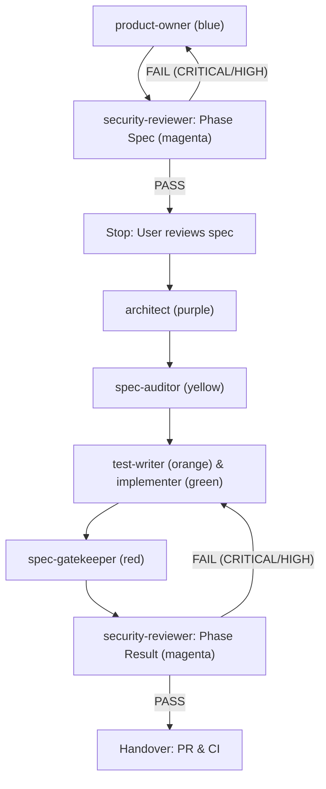

# Architecture

Overview of the Spec Kit agent team architecture, role execution lifecycle, and dual-phase review insertion.


## Pipeline and Roles

The pipeline coordinates autonomous subagents around GitHub Spec Kit. Each agent operates with defined scopes, models, and color-coded themes:

| Role | Color | Model | Phase / Scope |
|---|---|---|---|
| [`product-owner`](../agents/product-owner.md) | blue | sonnet | Spec phase (`spec.md`) |
| [`architect`](../agents/architect.md) | purple | opus | Plan & tasks phase (`plan.md`, `tasks.md`) |
| [`spec-auditor`](../agents/spec-auditor.md) | yellow | opus | Spec audit gate (against constitution) |
| [`test-writer`](../agents/test-writer.md) | orange | sonnet | TDD red phase (tests only) |
| [`implementer`](../agents/implementer.md) | green | sonnet | TDD green phase (production code) |
| [`spec-gatekeeper`](../agents/spec-gatekeeper.md) | red | sonnet | Final verification gate before PR |
| [`security-reviewer`](../agents/security-reviewer.md) | magenta | sonnet | Opt-in security review (spec & result phases) |
| [`patcher`](../agents/patcher.md) | cyan | sonnet | Fast track for small fixes (at most 30 lines) |

### Inline mode: `--team skill-agents`

Typed as `/speckit-team --team skill-agents <request>`, the same seven roles run in the main session
as installed skills (`speckit-role-<role>`, generated from the agents) and no agent is launched. The
hook keeps a role record from the role's Skill call to the end of that turn (its Stop, or the next
`prompt_id`): `scope role` limits its writes,
`lane role` checks its changes and records spec-auditor's verdict and spec-gatekeeper's word, and the
Skill call passes the audit gate before test-writer, implementer and spec-gatekeeper. Not enforced:
the retry limit, the report's last line, each role's own context and tool list. See the README's
"Running the roles as skills".

## Security Reviewer Dual-Gate Lifecycle

The `security-reviewer` agent is an opt-in reviewer (`/speckit-team --security` or `--team ...,security-reviewer`) executing in two inspection gates:

1. **Spec Review Phase (`phase: spec`)**:
   - Runs after `product-owner` reports `READY FOR PLAN`, before the user reviews `spec.md`.
   - Inspects `spec.md`, `plan.md`, and constitution for threat models, trust boundaries, auth/access controls, and sensitive data exposure.
   - On `FAIL` (CRITICAL or HIGH findings), routes findings back to `product-owner` (or the user if absent), then re-runs. After two FAILs the findings go to the user.
   - On `PASS`, advances to the user spec review stop.

2. **Result Review Phase (`phase: result`)**:
   - Runs after `spec-gatekeeper` verification (or after the final build round when `spec-gatekeeper` is absent), before handover.
   - Inspects the git diff (`git diff main...HEAD`), changed files, dependencies, and automated tests for OWASP vulnerabilities, secrets, and injection flaws.
   - On `FAIL` (CRITICAL or HIGH findings), routes findings to `implementer` or `test-writer` (or the user if absent). The fix changes code `spec-gatekeeper` approved, so `spec-gatekeeper` (when chosen) verifies again before the re-run. After two FAILs the findings go to the user.
   - Either phase's report must end in `VERDICT: PASS` or `VERDICT: FAIL`: an `ends` hook refuses it once otherwise.
   - On `PASS`, proceeds to PR handover.



## AI Architecture Diagram Prompt

Use this prompt to generate updated architectural diagrams:

```text
Software pipeline diagram showing Spec Kit agent team workflow with 7 roles:
1. Product Owner (blue): writes spec.md.
2. Security Reviewer Gate 1 (magenta): inspects spec.md for threat modeling, auth, and data exposure. Loops back on FAIL; advances to User Approval on PASS.
3. Architect (purple): writes plan.md and tasks.md.
4. Spec Auditor (yellow): verifies plan against constitution.
5. TDD Build Phase: Test Writer (orange, failing tests) & Implementer (green, code).
6. Spec Gatekeeper (red): acceptance verification.
7. Security Reviewer Gate 2 (magenta): inspects git diff and code for OWASP vulnerabilities and secrets. Loops to Implementer on FAIL; advances on PASS.
8. Handover: Git PR and CI checks.
Style: Clean architectural flowchart, colored nodes matching agent colors, directional arrows with loopbacks.
```
